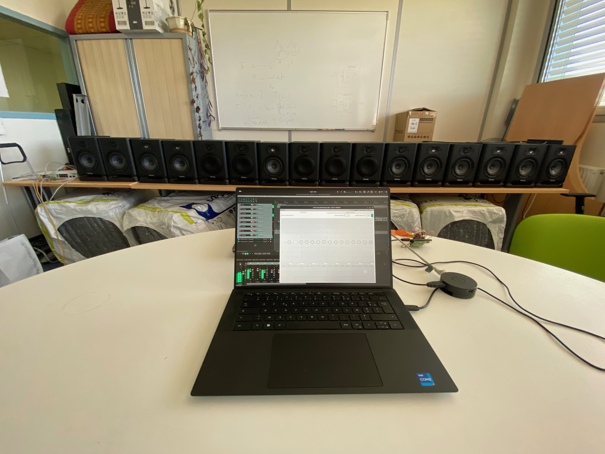
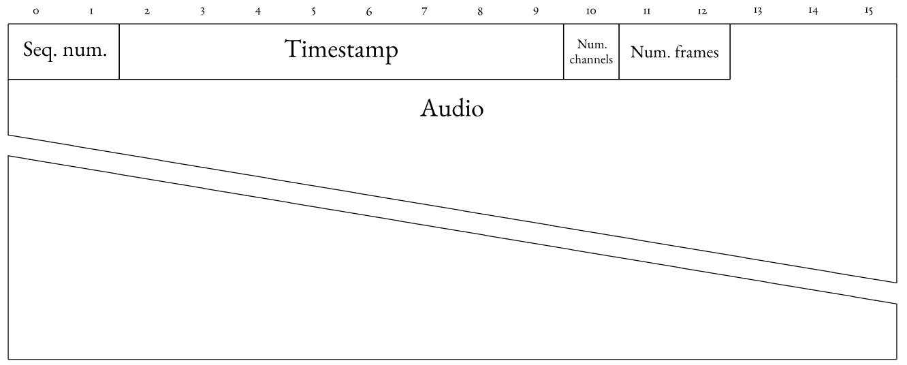
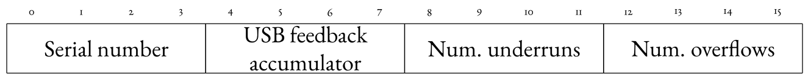
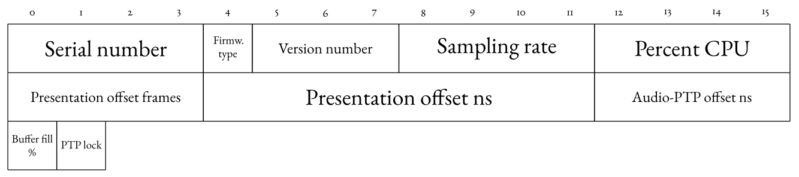

#+title: Ananas
#+subtitle: A Networked Audio System for Distributed Spatial Audio Applications
#+author: Thomas Rushton, Romain Michon, Tanguy Risset
#+date: October 2026
* Options                                                     :ignore:
#+options: toc:nil title:nil author:nil
#+latex_compiler: xelatex
#+cite_export: biblatex sorting=none
#+export_file_name: out/is2-2026-poster
#+latex_class: is2-2026-poster
#+latex_header_extra: \RequirePackage[]{is2-2026-poster}
#+latex_header: \newcommand{\authoremail}{thomas.rushton@inria.fr}
#+latex_header: \newcommand{\githubrepo}{https://github.com/hatchjaw/ananas-server}
#+beamer_theme: is226

* LaTeX package                                                    :noexport:
:PROPERTIES:
:header-args: :tangle out/is2-2026-poster.sty :results silent :noeval
:END:

** Provide the package

#+begin_src latex
\ProvidesPackage{is2-2026-poster}
#+end_src

** Packages

#+begin_src latex
\usepackage[orientation=portrait,size=a0,scale=1.4]{beamerposter}
\usepackage[absolute,overlay]{textpos}
\usepackage[sorting=none]{biblatex}
\usepackage[export]{adjustbox}
\usepackage{graphicx,caption}
\usepackage{minted}
\usepackage{eurosym}
\usepackage{listings}
\usepackage{textcomp}
\usepackage{bibentry}
\usepackage{siunitx}
\usepackage{microtype}
\usepackage{etoolbox}
\usepackage{ragged2e}
\usepackage{booktabs}
\usepackage{tikz}
\usetikzlibrary{positioning, arrows.meta, fit, calc, shapes}
\usepackage{bytefield}
#+end_src

** Typography

#+begin_src latex
\newcommand{\ultratiny}{\fontsize{8}{8}\selectfont}
\newcommand{\supertiny}{\fontsize{11}{11}\selectfont}
#+end_src

** Graphics

#+begin_src latex
\graphicspath{{./images}}
#+end_src

** Authors & affiliations

#+begin_src latex
\author{Thomas Rushton,$^{1}$ Romain Michon,$^{1}$ Tanguy Risset$^{2}$ 
\\[3ex]
\normalsize{$^{1}$Inria, INSA Lyon, CITI, EA3720, 69100 Villeurbanne, France}\\
\normalsize{$^{2}$INSA Lyon, Inria, CITI, EA3720, 69100 Villeurbanne, France}
}
#+end_src

** Bibliography

#+begin_src latex
\AtBeginBibliography{\small}
\AtEveryBibitem{
  \clearfield{pages}
  \clearfield{pagetotal}
  \clearfield{edition}
  \clearname{editor}
  \clearfield{url}
  \clearfield{urlyear}
  \clearfield{doi}
  \clearfield{eprintclass}
  \clearfield{eventtitle}
  \clearfield{isbn}
  \clearlist{publisher}
  \clearlist{location}
}
\renewcommand*{\bibfont}{\normalfont\footnotesize}
#+end_src

* Beamer theme                                                     :noexport:
:PROPERTIES:
:header-args: :tangle out/beamerthemeis226.sty :results silent :noeval
:END:

** Provide the package

#+begin_src latex
\ProvidesPackage{beamerthemeis226}
#+end_src

** Fonts

#+begin_src latex
\usepackage{fontspec}

\setsansfont[
  Mapping={tex-text}, 
  Numbers={OldStyle},
  Ligatures={Common},
  UprightFont=*-Regular,
  BoldFont=*-Bold,
  BoldItalicFont=*-BoldIt,
  ItalicFont=*-It,
  FontFace={sb}{n}{*-Semibold},
  FontFace={sb}{it}{*-SemiboldIt}
]{MinionPro}

\setmonofont[Scale=.9]{Iosevka Comfy Motion}

% Create commands for semibold
\DeclareRobustCommand{\sbseries}{\fontseries{sb}\selectfont}
\DeclareRobustCommand{\textsb}[1]{{\sbseries#1}}

% \usefonttheme{professionalfonts} prevents beamer from overwriting
% your fonts and is therefore needed to use specified font packages.
\usefonttheme{professionalfonts}

\usepackage{unicode-math}
#+end_src

** Colours

#+begin_src latex
%% \selectcolormodel{cmyk}
\mode<presentation>
#+end_src

Dark blue for the header background.

#+begin_src latex
\definecolor{cHeaderBg}{HTML}{001A31}
#+end_src

Same again for the footer background.

#+begin_src latex
\definecolor{cFooterBg}{HTML}{001A31}
#+end_src

Light grey for authors/affiliations, so they don't distract too much
from the title.

#+begin_src latex
\definecolor{cAuthorFg}{HTML}{DDDDDD}
#+end_src

Dark blue again for block titles.

#+begin_src latex
\definecolor{cTitleFg}{HTML}{001A31}
#+end_src

A lighter colour for block backgrounds.

#+begin_src latex
\definecolor{cBlockBg}{HTML}{D9E2EB}
#+end_src

Bibliography entry colours

#+begin_src latex
\definecolor{cBibAuthorFg}{HTML}{000060}
\definecolor{cBibNoteFg}{HTML}{374261}
#+end_src

** Header fonts & colours

#+begin_src latex
\setbeamercolor{headline}{fg=white,bg=cHeaderBg}
\setbeamercolor{title in headline}{fg=white}
\setbeamercolor{logo}{bg=white}
%\setbeamercolor{title in headline}{fg=blue}
%\setbeamercolor{author in headline}{fg=lightgray}
\setbeamercolor{author in headline}{fg=cAuthorFg}
\setbeamercolor{institute in headline}{fg=lightgray}
\setbeamercolor{logo in headline}{fg=black,bg=lightgray}
%% \setbeamercolor{separation line}{bg=i6colorscheme1}
#+end_src

** Footer fonts & colours

#+begin_src latex
\setbeamercolor{footline}{fg=white,bg=cFooterBg}
\setbeamerfont{footline}{size=\normalsize}
#+end_src

** Body fonts & colours

#+begin_src latex
\setbeamercolor*{normal text}{fg=black,bg=white}
#+end_src

** Bibliography fonts & colours

#+begin_src latex
\setbeamerfont{bibliography item}{size=\footnotesize}
\setbeamercolor{bibliography item}{fg=black,bg=white}

\setbeamerfont{bibliography entry author}{size=\footnotesize}
\setbeamercolor{bibliography entry author}{fg=cBibAuthorFg,bg=white}

%% \setbeamerfont{bibliography entry title}{size=\footnotesize}
%% \setbeamercolor{bibliography entry title}{fg=black,bg=white}

%% \setbeamerfont{bibliography entry location}{size=\footnotesize}
%% \setbeamercolor{bibliography entry location}{fg=black,bg=white}

\setbeamerfont{bibliography entry note}{size=\footnotesize}
\setbeamercolor{bibliography entry note}{fg=cBibNoteFg,bg=white}
#+end_src

** Block environment

#+begin_src latex
\setbeamercolor*{block body}{bg=cBlockBg,fg=black}
\setbeamerfont{block body}{size=\normalsize}
\setbeamercolor*{block title}{fg=cTitleFg,bg=white}
\setbeamerfont{block title}{size=\large,series=\bfseries}
#+end_src

** Example Environment

#+begin_src latex
\setbeamercolor*{example title}{fg=white,bg=cTitleFg}
\setbeamerfont{example title}{size=\large,series=\bfseries}

\setbeamerfont{alerted text}{size=\normalsize,series=\bfseries}
\setbeamercolor{alerted text}{fg=black}

\setbeamertemplate{itemize items}[circle]
\setbeamercolor{itemize item}{fg=cTitleFg}
\setbeamertemplate{navigation symbols}{}  % no navigation on a poster
#+end_src

** Caption

#+begin_src latex
\setbeamerfont{caption name}{series=\bfseries,size={\small}}
\setbeamerfont{caption}{size={\small}}
\setbeamercolor{caption name}{fg=black}
#+end_src

** Block

#+begin_src latex
\setbeamertemplate{block begin}{
  %% \vskip.75ex
  \begin{beamercolorbox}[leftskip=1cm,colsep*=.75ex,ht=3cm]{block title}%
    \usebeamerfont*{block title}\Large\insertblocktitle
  \end{beamercolorbox}%
  {\ifbeamercolorempty[bg]{block body}{}{\nointerlineskip\vskip-0.5pt}}%
  \usebeamerfont{block body}%
  \begin{beamercolorbox}[colsep*=.75ex,sep=.75ex,vmode]{block body}%
    \ifbeamercolorempty[bg]{block body}{\vskip-.25ex}{\vskip-.75ex}\vbox{}%
  }
  \setbeamertemplate{block end}{
  \end{beamercolorbox}
}
#+end_src

** Header

#+begin_src latex
\setbeamertemplate{headline}{  
  \leavevmode
  \begin{columns}[t,onlytextwidth]
    \column{\textwidth}
    \begin{beamercolorbox}[wd=\columnwidth, leftskip=2.0cm, ht=18cm]{headline}
    \usebeamercolor{title in headline}
        {\color{fg}\textbf{\textit{\Huge{\inserttitle}}}\\[3ex]}
    \usebeamercolor{title in headline}
        {\color{fg}\textsb{\huge{\insertsubtitle}}\\[7ex]} 
    \usebeamercolor{author in headline}
        {\color{fg}\large{\insertauthor}\\[1ex]}
    \vspace{2ex}
    \end{beamercolorbox}
    %% \column{.13\textwidth}
    %% \begin{beamercolorbox}[wd=\columnwidth]{logo}
    %% \centering
    %% \vskip2.10cm
    %% \includegraphics[width=0.8\linewidth]{logo.pdf}
    %% \vskip2.10cm
    %% \end{beamercolorbox}
  \end{columns}
  %\begin{beamercolorbox}[wd=\paperwidth]{lower separation line head}
  %  \rule{0pt}{2pt}
  %\end{beamercolorbox}
  %\begin{beamercolorbox}[wd=\paperwidth]{lower separation line head}
  %  \rule{0pt}{2pt}
  %\end{beamercolorbox}

  \begin{tikzpicture}[remember picture, overlay]
    \clip (0, 0) rectangle (\textwidth, 18cm);
    \node[anchor=north east, opacity=0.25] at ([xshift=8.5cm, yshift=9.575cm]current page.north east){
      \includegraphics[height=68cm]{wfs_blanc}
    };
  \end{tikzpicture}
}
#+end_src

** Footer

#+begin_src latex
\setbeamertemplate{footline}{
  \begin{columns}[t,onlytextwidth]
#+end_src

In the first column, display the logos.

#+begin_src latex
    \column{.6\textwidth}
    \begin{beamercolorbox}[wd=\columnwidth, ht=6cm, center]{headline}
      \includegraphics[height=5cm]{inria_blanc}
      \hspace{1cm}
      \includegraphics[height=5cm]{insa_blanc_crop}
      \hspace{1cm}
      \includegraphics[height=5cm]{citi_blanc}
      \vspace{.5cm}
    \end{beamercolorbox}
#+end_src

In the second, contact details.

#+begin_src latex    
    \column{.4\textwidth}
    \begin{beamercolorbox}[leftskip=1cm, wd=\columnwidth, ht=6cm]{headline}
      \begin{tabular}{rl}
        \textbf{Contact:} & \url{\authoremail} \\
        \textbf{Git:} & \url{\githubrepo}
      \end{tabular}
      \vspace{2.5ex}
    \end{beamercolorbox}
  \end{columns}
#+end_src

Draw a vertical line separating the two columns.

#+begin_src latex
  \begin{tikzpicture}[remember picture, overlay, baseline=(current bounding box.north)]
    \draw[line width=1.5mm] (0.6\textwidth, 0.1*6cm) -- (0.6\textwidth, 0.9*6cm);
  \end{tikzpicture}
}
#+end_src

** Last bits

#+begin_src latex
\mode<all>
\setbeamertemplate{caption}[numbered]
\def\footer#1{\def\insertfooter{#1}}
#+end_src

* TikZ figures                                                     :noexport:
:PROPERTIES:
:header-args: :tangle out/is2-2026-poster.sty :results silent :noeval
:END:

** Common stuff

#+begin_src latex
\definecolor{ctrlColour}{HTML}{479955}
\definecolor{audioColour}{HTML}{4077D6}
\definecolor{usbColour}{HTML}{D63E3E}

\pgfdeclarelayer{superbackground}
\pgfdeclarelayer{background}
\pgfdeclarelayer{foreground}
\pgfdeclarelayer{superforeground}
\pgfsetlayers{superbackground,background,main,foreground,superforeground}

\tikzset{
  device/.style={draw, fill=black!10, rounded corners=1mm, inner xsep=1.0mm, align=center},
  ctrl/.style={densely dotted, ctrlColour, line width=.2mm},
  ctrlArrow/.style={ctrl, -{Triangle[open]}},
  acn/.style={-{Stealth}, audioColour, densely dashdotted},
  audio/.style={-{Stealth}, audioColour},
  ptp/.style={{Triangle}-{Triangle}},
  usb/.style={{Triangle[open]}-{Triangle[open]}, usbColour},
  module/.style={device, fill=ctrlColour!35, transform shape},
  authority/.style={device, fill=usbColour!35}
}
#+end_src

** WFS

#+begin_src latex
\newcommand*{\wfsX}{4}
\newcommand*{\wfsWaveSpace}{.89}
\newcommand*{\wfsWidth}{8}
\newcommand*{\wfsNumWaves}{5}
\newcommand*{\wfsNumSecondary}{16}
\newcommand*{\wfsNumMCU}{8}

\tikzset{
  cross/.pic = {
    \draw[rotate = 45] (-#1,0) -- (#1,0);
    \draw[rotate = 45] (0,-#1) -- (0, #1);
  },
  wfsModule/.pic = {
    \node [module, font=\ultratiny] {dWFS};
  },
  wavefronts/.pic={
    \foreach \pos/\rad in {0/.18, 1/.615, 2/1.03, 3/1.42, 4/1.78, 5/2.07, 6/2.295, 7/2.42} {
      \draw [black!25] (-\wfsX+.25+.5*\pos, 2) circle (\rad);
    }
  },
  speaker/.pic={
    \path [draw=black, fill=white] (-.11, 0) rectangle (.11, .06);
    \path [draw=black, fill=white] (-.11, .06) -- (-.25, .2) -- (.25, .2) -- (.11, .06);
  },
  wfs/.pic={
    % Virtual sound field
    \draw [fill=white] (-\wfsX, -.5) rectangle (\wfsX, 2);
    
    \begin{scope}
      \clip (-\wfsX, -.5) rectangle (\wfsX, 2);

      % Virtual sound source
      \node [circle, draw=audioColour, fill=audioColour!50, thick]
      (primary) at (0, 0) {};

      % Virtual wavefronts
      \foreach \i [
        evaluate=\i as \rad using \i*\wfsWaveSpace
      ] in {1,...,\wfsNumWaves} {
        \draw [thick, dashed, audioColour] (-\rad, 0)
        arc [radius=\rad, start angle=180, end angle=0];
      }

      % Labels
      \node [
        black!50, fill=white, align=center,
        font={\itshape}
      ] at (-3.15, .1) {Virtual\\soundfield};
      \node [
        below right=-1mm and -1mm of primary,
        font={\itshape}
      ] {Virtual sound source};

      \foreach \i [
        evaluate=\i as \secondary using
        -\wfsX+.25+(\i-1)*(2*\wfsX/\wfsNumSecondary)
      ] in {1,...,\wfsNumSecondary} {
        \node (\secondary) at (\secondary, 2) {};
      }

      % Virtual source co-ordinates and ctrl line
      \draw [ctrl] node [above right=.1mm]
            {\((x, y)\)} (primary) -- (0, 2);
    \end{scope}

    % Infrastructure
    \begin{scope}[yshift=2cm]
      \node (server) [device, inner xsep=7.5mm] at (0, .75) {Server};
      \node (authority) [authority, above=4mm of server]
            {Time\\authority};
      \node (switch) [device, inner xsep=7.5mm, above=4mm of authority]
            {Switch};

      % USB arrow
      \draw [usb] ([xshift=-5mm] authority.south) --
      ([xshift=-5mm] server.north)

      % PTP arrows
      \draw [ptp] (authority.north) -- (switch.south);
      \draw [-{Triangle}] ([xshift=5mm] authority.south) --
      ([xshift=5mm] server.north);

      % Audio arrow
      \draw [audio] ([xshift=-11mm] server.north) --
      ([xshift=-11mm] switch.south);

      % Control arrow
      \draw [ctrlArrow] ([xshift=11mm] server.north) --
      ([xshift=11mm] switch.south);

      % Modules
      \foreach \i [
        evaluate=\i as \xpos using -\wfsX+.5+(\i-1)*(2*\wfsX/\wfsNumMCU)
      ] in {1,...,\wfsNumMCU} {
        \pic at (\xpos, 4.6) {wfsModule};
        
        \draw [audio] (\xpos-.2, 4.0) -- (\xpos-.2, 4.375);
        \draw [ctrlArrow] (\xpos, 4.0) -- (\xpos, 4.375);
        
        \ifnum\i=1
          \draw [-{Triangle}] (switch.north) +(0, .7) --
          (\xpos-.2, 4.0) (\xpos+.2, 4.0) -| (\xpos+.2, 4.375);
        \else
          \ifnum\i=\wfsNumMCU
            \draw [ptp] (switch.north) -- +(0, .7) -| (\xpos+.2, 4.375);
          \else
            \draw [-{Triangle}] (\xpos+.2, 4.0) -- (\xpos+.2, 4.375);
          \fi
        \fi
      }

      % Secondary sources
      \foreach \i [
        evaluate=\i as \secondary using
        -\wfsX+.25+(\i-1)*(2*\wfsX/\wfsNumSecondary)
      ] in {1,...,\wfsNumSecondary} {
        \pic at (\secondary, 0) {cross=2pt};
        
        \ifnum\i=1
          \draw [ctrl] (\secondary,0) -- +(0, .2) -|
          ([yshift=-3mm] server.south);
        \else
          \ifnum\i=\wfsNumSecondary
            \draw [ctrlArrow] (\secondary,0) --
            +(0, .2) -| (server.south);
          \else
            \draw [ctrl] (\secondary,0) -- +(0, .2);
          \fi
        \fi

        \pic at (\secondary, 4.845) {speaker};
      }

      \draw [ctrl] (0, 0) -- (0, .2);

      % Legend
      \matrix [ampersand replacement=\&, draw, fill=white, font=\ultratiny] at (-2.75, 2) {
        \draw [ctrlArrow] (0,0) -- (.5,0); \& \node [legend] {Control data}; \\
        \draw [audio] (0,0) -- (.5,0); \& \node [legend] {Audio}; \\
        \draw [-{Triangle}] (0,0) -- (.5,0); \& \node [legend] {PTP}; \\
        \draw [usb] (0,0) -- (.5,0); \& \node [legend] {USB}; \\
      };
    \end{scope}

    % Synthesised soundfield
    \begin{scope}[yshift=5.055cm]
      \clip (-\wfsX, 2) rectangle (\wfsX, 4.6);
      \draw [white, fill=white] (-\wfsX, 2) rectangle (\wfsX, 4.6);

      \foreach \i [evaluate=\i as \rad using \i*\wfsWaveSpace] in {1,...,\wfsNumWaves} {
        \draw [thick, audioColour] (-\rad, 0) arc [radius=\rad, start angle=180, end angle=0];
      }

      \pic {wavefronts};
      \pic [xscale=-1] {wavefronts};

      \node [black!50, align=center, font={\itshape}] at (-3.15, 4) {Synthesised\\soundfield};
    \end{scope}
  }
}
#+end_src

** HOA

#+begin_src latex
\tikzset{
  selector/.pic={
    \draw[rotate=45, very thick, ctrlColour] (-#1,0) -- (#1,0);
    \draw[rotate=45, very thick, ctrlColour] (0,-#1) -- (0, #1);
  },
  speakerHOA/.pic = {
    \draw (-.11, 0) rectangle (.11, .06);
    \draw (-.11, .06) -- (-.25, .2) -- (.25, .2) -- (.11, .06);
    \node (-body) at (0, 0) {};   % invisible anchor node
  },
  moduleN/.pic = {
    \node [module] (-body) {dHOA};
    \draw [ptp] (0, .6) -- (-body.north);
    \draw [acn] (-.25, .6) -- ([xshift=-.25cm]-body.north);
    \draw [ctrlArrow] (.25, .6) -- ([xshift=.25cm]-body.north);
  },
  moduleS/.pic = {
    \node [module] (-body) {dHOA};
    \draw [ptp] (0, -.6) -- (-body.south);
    \draw [acn] (-.25, -.6) -- ([xshift=-.25cm]-body.south);
    \draw [ctrlArrow] (.25, -.6) -- ([xshift=.25cm]-body.south);
  },
  hoa/.pic={
    \begin{scope}[yshift=11.5cm]
      % Synthesised soundfield
      \draw [thick, fill=white] (-4, -4) rectangle (4, 4);
      % Azymuthal rings
      \draw [dashed, black!30] (0, 0) circle (3.5);
      \draw [dashed, black!30] (0, 0) circle (1.9);
      % Speakers, ring 0
      \pic [rotate=180] (speaker0) at (0, 3.7) {speakerHOA};
      \pic [rotate=135] (speaker1) at (2.625, 2.625) {speakerHOA};
      \pic [rotate=90] (speaker2) at (3.7, 0) {speakerHOA};
      \pic [rotate=45] (speaker3) at (2.625, -2.625) {speakerHOA};
      \pic (speaker4) at (0, -3.7) {speakerHOA};
      \pic [rotate=-45] (speaker5) at (-2.625, -2.625) {speakerHOA};
      \pic [rotate=-90] (speaker6) at (-3.7, 0) {speakerHOA};
      \pic [rotate=-135] (speaker7) at (-2.625, 2.625) {speakerHOA};
      % Speakers, ring 1
      \pic [rotate=202.5] (speaker8) at (-.8, 1.925) {speakerHOA};
      \pic [rotate=157.5] (speaker9) at (.8, 1.925) {speakerHOA};
      \pic [rotate=112.5] (speaker10) at (1.925, .8) {speakerHOA};
      \pic [rotate=67.5] (speaker11) at (1.925, -.8) {speakerHOA};
      \pic [rotate=22.5] (speaker12) at (.8, -1.925) {speakerHOA};
      \pic [rotate=-22.5] (speaker13) at (-.8, -1.925) {speakerHOA};
      \pic [rotate=-67.5] (speaker14) at (-1.925, -.8) {speakerHOA};
      \pic [rotate=-112.5] (speaker15) at (-1.925, .8) {speakerHOA};
      % Modules
      \pic [rotate=-22.5] (module0) at (1.5, 3.5) {moduleS};
      \pic [rotate=67.5] (module1) at (3.5, -1.5) {moduleN};
      \pic [rotate=-22.5] (module2) at (-1.5, -3.5) {moduleN};
      \pic [rotate=67.5] (module3) at (-3.5, 1.5) {moduleS};
      \pic (module4) at (0, 2.25) {moduleN};
      \pic (module5) [rotate=90] at (2.25, 0) {moduleS};
      \pic (module6) at (0, -2.25) {moduleS};
      \pic [rotate=-90] (module7) at (-2.25, 0) {moduleS};
      % Audio
      \draw [audio] (module0-body.west) -- ([xshift=-.05cm]speaker0-body.east);
      \draw [audio] (module0-body.east) -- ([yshift=.05cm, xshift=.1cm]speaker1-body.west);
      \draw [audio] (module1-body.east) -- ([yshift=-.1cm, xshift=.1cm]speaker2-body.west);
      \draw [audio] (module1-body.west) -- ([yshift=.05cm, xshift=-.1cm]speaker3-body.east);
      \draw [audio] (module2-body.east) -- ([yshift=.05cm, xshift=.05cm]speaker4-body.west);
      \draw [audio] (module2-body.west) -- ([yshift=-.05cm]speaker5-body.east);
      \draw [audio] (module3-body.west) -- ([yshift=.1cm, xshift=-.1cm]speaker6-body.east);
      \draw [audio] (module3-body.east) -- ([yshift=-.05cm, xshift=.1cm]speaker7-body.west);
      \draw [audio] (module4-body.west) -- ([yshift=.125cm]speaker8-body.south);
      \draw [audio] (module4-body.east) -- ([yshift=.125cm]speaker9-body.south);
      \draw [audio] (module5-body.east) -- ([yshift=.125cm]speaker10-body.south);
      \draw [audio] (module5-body.west) -- ([yshift=.1cm]speaker11-body.south);
      \draw [audio] (module6-body.east) -- ([yshift=.125cm]speaker12-body.south);
      \draw [audio] (module6-body.west) -- ([yshift=.125cm]speaker13-body.south);
      \draw [audio] (module7-body.east) -- ([yshift=.1cm]speaker14-body.south);
      \draw [audio] (module7-body.west) -- ([yshift=.125cm]speaker15-body.south);
    \end{scope}
    \begin{scope}[yshift=5.5cm]
      % Switch
      \node[device, inner xsep=8mm, inner ysep=2.5mm](switch) at (0, 1) {Switch};
      % Time authority
      \node[authority, align=center](authority) at (0, -.5) {Time\\authority};
      % PTP
      \draw [{Triangle}-] (.5, -1.5) -- ([xshift=5mm] authority.south);
      \draw [ptp] (authority.north) -- (switch.south);
      \draw [ptp] (switch.north) -- (0, 2);
      % USB
      \draw [usb] (-.5, -1.5) -- ([xshift=-5mm] authority.south);
      % ACN-format
      \draw [acn] (-1.1, -1.5) -- ([xshift=-1.1cm] switch.south);
      \draw [acn] ([xshift=-1.1cm] switch.north) -- (-1.1, 2);
      % Coordinates
      \draw [ctrlArrow] (1.1, -1.5) -- ([xshift=1.1cm] switch.south);
      \draw [ctrlArrow] ([xshift=1.1cm] switch.north) -- (1.1, 2);

      % Legend
      \matrix [draw, fill=white, font=\ultratiny, ampersand replacement=\&] at (-2.75, 0.25) {
        \draw [ctrlArrow] (0,0) -- (.5,0); \& \node [legend] {Decoder coeff's}; \\
        \draw [acn] (0,0) -- (.5,0); \& \node [legend] {ACN-format}; \\
        \draw [audio] (0,0) -- (.5,0); \& \node [legend] {Audio}; \\
        \draw [-{Triangle}] (0,0) -- (.5,0); \& \node [legend] {PTP}; \\
        \draw [usb] (0,0) -- (.5,0); \& \node [legend] {USB}; \\
        \pic at (.25, 0) {selector=5pt}; \& \node [legend] {Module selector}; \\
      };
    \end{scope}
    \begin{scope}
      % DAW
      \draw [fill=white, thick] (-4, -4) rectangle (4, 4);
      \node [] at (-3.25, 3.5) {DAW};
      % Virtual soundfield
      \draw [thick] (0, 0) circle (3.5);
      \node [black!75, align=center, font={\itshape}] at (0, 0) {Virtual\\soundfield};
      % Azymuthal rings
      \draw [dotted, black!50] (0, 0) circle (1.9);
      % Module selectors
      \pic at (1.2, 3.275) {selector=5pt};
      \pic at (3.275, -1.2) {selector=5pt};
      \pic at (-1.2, -3.275) {selector=5pt};
      \pic at (-3.275, 1.2) {selector=5pt};
      \pic at (0, 1.9) {selector=5pt};
      \pic at (1.9, 0) {selector=5pt};
      \pic at (0, -1.9) {selector=5pt};
      \pic at (-1.9, 0) {selector=5pt};
      % Speakers, ring 0
      \pic [rotate=180] (speaker0) at (0, 3.7) {speakerHOA};
      \pic [rotate=135] (speaker1) at (2.625, 2.625) {speakerHOA};
      \pic [rotate=90] (speaker2) at (3.7, 0) {speakerHOA};
      \pic [rotate=45] (speaker3) at (2.625, -2.625) {speakerHOA};
      \pic (speaker4) at (0, -3.7) {speakerHOA};
      \pic [rotate=-45] (speaker5) at (-2.625, -2.625) {speakerHOA};
      \pic [rotate=-90] (speaker6) at (-3.7, 0) {speakerHOA};
      \pic [rotate=-135] (speaker7) at (-2.625, 2.625) {speakerHOA};
      % Speakers, ring 1
      \pic [rotate=202.5] (speaker8) at (-.8, 1.925) {speakerHOA};
      \pic [rotate=157.5] (speaker9) at (.8, 1.925) {speakerHOA};
      \pic [rotate=112.5] (speaker10) at (1.925, .8) {speakerHOA};
      \pic [rotate=67.5] (speaker11) at (1.925, -.8) {speakerHOA};
      \pic [rotate=22.5] (speaker12) at (.8, -1.925) {speakerHOA};
      \pic [rotate=-22.5] (speaker13) at (-.8, -1.925) {speakerHOA};
      \pic [rotate=-67.5] (speaker14) at (-1.925, -.8) {speakerHOA};
      \pic [rotate=-112.5] (speaker15) at (-1.925, .8) {speakerHOA};
    \end{scope}
  }
}
#+end_src

** System Overview

#+begin_src latex
\tikzset{
  systemOverview/.pic={
    \node (auth) [authority] at (0, 0) {Time\\authority};
    \node (switch) [device, above=5mm of auth, inner xsep=10mm] {Switch};
    \node (server) [device, below=5mm of auth, inner xsep=10mm] {Server};
    \node (module0) [module, above left=5mm and -7mm of switch] {T41};
    \node (moduleN) [module, above right=5mm and -7mm of switch] {T41};
    \node [above=5mm of switch] {\(\cdots\)};

    % PTP between authority and switch
    \draw [ptp] (auth.north) -- (switch.south);

    % PTP between switch and modules
    \draw [ptp] ([xshift=-13.3mm]switch.north) --
    ([xshift=-2mm]module0.south);
    \draw [ptp] ([xshift=9.3mm]switch.north) --
    ([xshift=-2mm]moduleN.south);

    % USB audio
    \draw [usb] ([xshift=-4mm]auth.south) --
    ([xshift=-4mm]server.north);

    % PTP follow-up from authority to server
    \draw [-{Triangle}] ([xshift=4mm]auth.south) --
    ([xshift=4mm]server.north);

    % Audio from server to switch
    \draw [audio] ([xshift=-12.5mm]server.north) --
    ([xshift=-12.5mm]switch.south);

    % Ctrl from server to switch
    \draw [ctrlArrow] ([xshift=12.5mm]server.north) --
    ([xshift=12.5mm]switch.south);

    % Audio from switch to modules
    \draw [audio] ([xshift=-11.3mm]switch.north) -- (module0.south);
    \draw [audio] ([xshift=11.3mm]switch.north) -- (moduleN.south);

    % Ctrl from switch to modules
    \draw [ctrlArrow] ([xshift=-9.3mm]switch.north) --
    ([xshift=2mm]module0.south);
    \draw [ctrlArrow] ([xshift=13.3mm]switch.north) --
    ([xshift=2mm]moduleN.south);
  }
}
#+end_src

* The Poster
:PROPERTIES:
:BEGIN:
:BEAMER_env: fullframe
:END:

# It'd be nice if I knew how to reduce vertical spacing after the
# header without resorting to this sort of nonsense.
#+latex: \vspace{-2cm}

** Left column                                                        :BMCOL:
:PROPERTIES:
:BEAMER_col: 0.48
:BEAMER_opt: [t]
:END:
*** Motivation                                                      :B_block:
:PROPERTIES:
:BEAMER_env: block
:END:

#+latex: \justifying

Audio over ethernet is the de facto standard in multichannel audio
transmission, and yet existing networked audio systems are either
*proprietary and expensive* (e.g., Dante) or unsuited to
*timing-critical applications* such as spatial audio (e.g., JackTrip,
AOO). We propose */Ananas/*, a networked audio system consisting of:

- A *protocol suite* for audio and control data transmission, device
  discovery, and synchronisation.
- Digital audio workstation-based *interfaces* for spatial audio control.
- Microcontroller firmware for *distributed, parallelised spatial audio*
  algorithms.

Ananas seeks to *lower the barrier to entry* for the sound field
synthesis techniques of wave field synthesis (WFS) and higher order
ambisonics (HOA). Typically, systems for WFS and HOA are centralised,
reliant on costly highly-multichannel audio interfaces and their
accessibility is thus limited. Representing *a distributed alternative*,
Ananas renders access to such systems more attainable.

*** System Overview

#+latex: \justifying

In terms of hardware, Ananas is a *general purpose computer* running a
CLAP format digital audio workstation plugin, an *ethernet switch* with
IEEE 1588 *Precision Time Protocol* (PTP) capabilities, and a network of
*microcontroller development boards* one of which acts as an
*authoritative source of time* and the rest of which perform a
*parallelised, distributed* spatial audio algorithm. A given Ananas
plugin encapsulates a UDP multicast *audio server* and an OSC-based
*control data server*. Chosen for its low cost and high port count, the
MikroTik *CRS326-246-2S+IN* is our ethernet switch of choice. Likewise
chosen for its low cost, networking support including *PTP
functionality*, and dedicated, *highly-configurable* audio subsystem, is
the *Teensy 4.1* microcontroller development board, which is the
platform for our *distributed signal processing modules*. DSP is written
in the Faust programming language and modules are programmable /en
masse/ via shell scripts.

**** Left                                                             :BMCOL:
:PROPERTIES:
:BEAMER_col: 0.333
:END:

#+attr_org: :width 200

**** Center                                                           :BMCOL:
:PROPERTIES:
:BEAMER_col: 0.333
:END:

#+latex: \begin{center}\scalebox{2.3}{
\begin{tikzpicture}[font=\supertiny]
  \node [] at (0, 0) {
    \includegraphics[width=5cm]{./images/switch}
  };
  \node [draw=red!50!black, ultra thick, star, star points=10, rotate=15, fill=yellow, inner sep=.1mm] at (1.75, .75) {€ 200};
\end{tikzpicture}
#+latex: }\end{center}

**** Right                                                            :BMCOL:
:PROPERTIES:
:BEAMER_col: 0.333
:END:

#+latex: \begin{center}\scalebox{2.3}{
\begin{tikzpicture}[font=\supertiny]
  \node [] at (0, 0) {
    \includegraphics[width=4.75cm]{./images/module}
  };
  \node [draw=red!50!black, ultra thick, star, star points=10, rotate=15, fill=yellow, inner sep=.1mm] at (1.75, .75) {€ 48};
\end{tikzpicture}
#+latex: }\end{center}

*** The Time Authority

#+latex: \justifying

One Teensy acts as an authoritative source of time. It is programmed
as a USB audio device, so it *governs audio timing* on the machine
running the audio server. It is also programmed as a PTP clock
authority, so it *governs PTP time* for the ethernet switch and all the
Teensy modules that are connected to it. To combat *clock drift*, audio
time for the DSP modules is inferred from PTP time via *media clock
recovery* and *presentation time recovery* algorithms. The Teensy 4.1's
MCU features 30-bit clock divider registers, so *nanosecond order
timing corrections* are possible. The server reads PTP follow-up
packets and uses their timing information to timestamp outgoing audio
packets.

#+latex: \begin{center}{\fontsize{10pt}{12pt}\selectfont\scalebox{2.5}{
\begin{tikzpicture}
  \pic {systemOverview};
\matrix [draw, fill=white, ampersand replacement=\&] at (3.75, 0) {
    \draw [ctrlArrow] (0,0) -- (.5,0); \& \node [legend] {Control data (UDP)}; \\
    \draw [audio] (0,0) -- (.5,0); \& \node [legend] {Audio (UDP)}; \\
    \draw [-{Triangle[open]}, usbColour] (0,0) -- (.5,0); \& \node [legend] {USB audio}; \\
    \draw [-{Triangle}] (0,0) -- (.5,0); \& \node [legend] {PTP}; \\
  };
\end{tikzpicture}
#+latex: }}\end{center}

** Right column                                       :BMCOL:
:PROPERTIES:
:BEAMER_col: 0.48
:BEAMER_opt: [t]
:END:

*** Protocol

**** Left                                                             :BMCOL:
:PROPERTIES:
:BEAMER_col: .48
:BEAMER_opt: [t]
:END:

#+latex: \justifying

#+attr_latex: :width \linewidth

Ananas client description protocol (ACDP, right) packets are sent
periodically by connected modules, and provide information such as
firmware type, sampling rate and PTP status.

#+attr_latex: :width \linewidth

**** Right                                                            :BMCOL:
:PROPERTIES:
:BEAMER_col: .48
:BEAMER_opt: [t]
:END:

#+latex: \justifying
The Ananas audio procol (AAP, left) consists of a stream of
sequence-numbered, timestamped packets of audio data, also containing a
channel count and a number of frames. At 16 frames, up to 44 channels are supported. 

#+attr_latex: :width \linewidth

The time authority also sends periodic authority description packets
(AADP, left) which can be displayed in a plugin for debugging purposes. 

*** Distributed Spatial Audio                                       :B_block:
:PROPERTIES:
:BEAMER_env: block
:END:

**** Left
:PROPERTIES:
:BEAMER_col: 0.48
:BEAMER_opt: [T]
:END:

#+latex: \justifying

Ananas supports *WFS* (below) and *third-order HOA* (right). For WFS,
modules receive monophonic virtual sound sources via AAP and control
data consisting of virtual sound source co-ordinates and pairs of
loudspeaker co-ordinates, and compute the appropriate per-loudspeaker
delays and prefilters accordingly. For HOA, modules receive
ACN-encoded audio over AAP and pairs of decoder matrix rows as control
data and compute the requisite dot products.

#+latex: \begin{center}{\fontsize{10pt}{12pt}\selectfont\scalebox{2}{
\begin{tikzpicture}
  \pic {wfs};
\end{tikzpicture}
#+latex: }}\end{center}

**** Right
:PROPERTIES:
:BEAMER_col: 0.48
:BEAMER_opt: [T]
:END:

#+latex: \justifying

#+latex: \begin{center}{\fontsize{10pt}{12pt}\selectfont\scalebox{2}{
\begin{tikzpicture}
  \pic{hoa};
\end{tikzpicture}
#+latex: }}\end{center}

*** Synchronisation

Teensy modules remain synchronised to on the order of *\pm200 ns*, well
within the AES guideline of 5% of the reference frame (1 \micro{}s @ 48
kHz). As a distributed system, Ananas is more than capable of
supporting its parallelised spatial audio algorithms.

#+begin_src julia :results none :session :exports none
using CSV, DataFrames, Plots, LaTeXStrings, Statistics

function plotHistogram(index, ip)
    # The number of datapoints, i.e. seconds, to plot
    numData = 3600

    # Read the data. Limit to 3600 data points, i.e. 1 hour's worth.
    data = CSV.read(
        "../../notes/20260303T221301--ananas-synchronicity-measurements-data__ananas_data_teensy.csv",
        DataFrame,
        limit=numData + 1
    )

    # Make the unit nanoseconds
    data = data .* 1e9
    # Remove the initial offset (using I2S3 as the reference)
    data = data .- data[1, 3]

    histogram(Matrix(data)[:, index], bins=30,
              fontfamily="Minion Pro Regular",
              xlabel="Offset (ns)",
              ylabel="Frequency",
              label="$ip")

    savefig("./images/gen/histo$index.png")
end
#+end_src

**** Left                                                             :BMCOL:
:PROPERTIES:
:BEAMER_col: .333
:END:

#+begin_src julia :results file graphics :file histo1.png :output-dir ./images/gen :session :exports results
plotHistogram(1, "192.168.198.18")
#+end_src
#+attr_org: :width 300
#+RESULTS:
[[file:./images/gen/histo1.png]]

**** Center                                                           :BMCOL:
:PROPERTIES:
:BEAMER_col: .333
:END:

#+begin_src julia :results file graphics :file histo2.png :output-dir ./images/gen :session :exports results
plotHistogram(2, "192.168.48.236")
#+end_src
#+attr_org: :width 300
#+RESULTS:
[[file:./images/gen/histo2.png]]

**** Right                                                            :BMCOL:
:PROPERTIES:
:BEAMER_col: .333
:END:

#+begin_src julia :results file graphics :file histo4.png :output-dir ./images/gen :session :exports results
plotHistogram(4, "192.168.48.191")
#+end_src
#+attr_org: :width 300
#+RESULTS:
[[file:./images/gen/histo4.png]]

* Local variables                                                  :noexport:

#+begin_example
Local Variables:
org-latex-classes: (("is2-2026-poster"
"\\documentclass[final]{beamer}
[NO-DEFAULT-PACKAGES]"))
org-latex-listings: minted
End:
#+end_example
