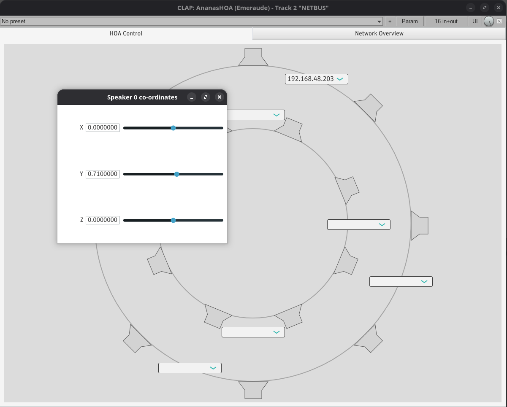

#+title: Ambisonics
#+subtitle: Introducing an Accessible, Distributed Approach
#+author: Thomas Rushton, Romain Michon, Tanguy Risset, Clemens Wegener, Pierre Lecomte
#+date: October 2026
* Options                                                     :ignore:
#+options: toc:nil title:nil author:nil
#+latex_compiler: xelatex
#+cite_export: biblatex sorting=none
#+export_file_name: out/smc-2026-poster
#+latex_class: smc-2026-poster
#+latex_header_extra: \RequirePackage[]{smc-2026-poster}
#+latex_header: \newcommand{\authoremail}{thomas.rushton@inria.fr}
#+latex_header: \newcommand{\githubrepo}{https://github.com/hatchjaw/ananas-server}
#+beamer_theme: smc26

* LaTeX package                                                    :noexport:
:PROPERTIES:
:header-args: :tangle out/smc-2026-poster.sty :results silent :noeval
:END:

** Provide the package

#+begin_src latex
\ProvidesPackage{smc-2026-poster}
#+end_src

** Packages

#+begin_src latex
\usepackage[orientation=portrait,size=a0,scale=1.4]{beamerposter}
\usepackage[absolute,overlay]{textpos}
\usepackage[sorting=none]{biblatex}
\usepackage[export]{adjustbox}
\usepackage{graphicx,caption}
\usepackage{minted}
\usepackage{eurosym}
\usepackage{listings}
\usepackage{textcomp}
\usepackage{bibentry}
\usepackage{siunitx}
\usepackage{microtype}
\usepackage{etoolbox}
\usepackage{ragged2e}
\usepackage{booktabs}
\usepackage{tikz}
\usetikzlibrary{positioning, arrows.meta, fit, calc, shapes}
\usepackage{bytefield}
#+end_src

** Typography

#+begin_src latex
\newcommand{\ultratiny}{\fontsize{8}{8}\selectfont}
\newcommand{\supertiny}{\fontsize{11}{11}\selectfont}
#+end_src

** Graphics

#+begin_src latex
\graphicspath{{./images}}
#+end_src

** Authors & affiliations

#+begin_src latex
\author{Thomas Rushton,$^{1}$ Romain Michon,$^{2}$ Tanguy Risset,$^{1}$ 
Clemens Wegener,$^{1}$ Pierre Lecomte$^{3}$\\[3ex]
\normalsize{$^{1}$Inria, INSA Lyon, CITI, EA3720, 69100 Villeurbanne, France}\\
\normalsize{$^{2}$Université Jean Monnet, Eclla, Inria Emeraude Team, Saint-Étienne, France}\\
\normalsize{$^{3}$École Centrale de Lyon, 36 Av. Guy de Collongue, 69130 Écully, France}
}
#+end_src

** Bibliography

#+begin_src latex
\AtBeginBibliography{\small}
\AtEveryBibitem{
  \clearfield{pages}
  \clearfield{pagetotal}
  \clearfield{edition}
  \clearname{editor}
  \clearfield{url}
  \clearfield{urlyear}
  \clearfield{doi}
  \clearfield{eprintclass}
  \clearfield{eventtitle}
  \clearfield{isbn}
  \clearlist{publisher}
  \clearlist{location}
}
\renewcommand*{\bibfont}{\normalfont\footnotesize}
#+end_src

* Beamer theme                                                     :noexport:
:PROPERTIES:
:header-args: :tangle out/beamerthemesmc26.sty :results silent :noeval
:END:

** Provide the package

#+begin_src latex
\ProvidesPackage{beamerthemesmc26}
#+end_src

** Fonts

#+begin_src latex
\usepackage{fontspec}

\setsansfont[
  Mapping={tex-text}, 
  Numbers={OldStyle},
  Ligatures={Common},
  UprightFont=*-Regular,
  BoldFont=*-Bold,
  BoldItalicFont=*-BoldIt,
  ItalicFont=*-It,
  FontFace={sb}{n}{*-Semibold},
  FontFace={sb}{it}{*-SemiboldIt}
]{MinionPro}

\setmonofont[Scale=.9]{Iosevka Comfy Motion}

% Create commands for semibold
\DeclareRobustCommand{\sbseries}{\fontseries{sb}\selectfont}
\DeclareRobustCommand{\textsb}[1]{{\sbseries#1}}

% \usefonttheme{professionalfonts} prevents beamer from overwriting
% your fonts and is therefore needed to use specified font packages.
\usefonttheme{professionalfonts}

\usepackage{unicode-math}
#+end_src

** Colours

#+begin_src latex
%% \selectcolormodel{cmyk}
\mode<presentation>
#+end_src

Dark green for the header background.

#+begin_src latex
\definecolor{cHeaderBg}{HTML}{18431c}
#+end_src

Same again for the footer background.

#+begin_src latex
\definecolor{cFooterBg}{HTML}{18431c}
#+end_src

Light grey for authors/affiliations, so they don't distract too much
from the title.

#+begin_src latex
\definecolor{cAuthorFg}{HTML}{DDDDDD}
#+end_src

Dark green again for block titles.

#+begin_src latex
\definecolor{cTitleFg}{HTML}{18431c}
#+end_src

A lighter colour for block backgrounds.

#+begin_src latex
\definecolor{cBlockBg}{HTML}{e4eee5}
#+end_src

Bibliography entry colours

#+begin_src latex
\definecolor{cBibAuthorFg}{HTML}{006000}
\definecolor{cBibNoteFg}{HTML}{37613d}
#+end_src

** Header fonts & colours

#+begin_src latex
\setbeamercolor{headline}{fg=white,bg=cHeaderBg}
\setbeamercolor{title in headline}{fg=white}
\setbeamercolor{logo}{bg=white}
%\setbeamercolor{title in headline}{fg=blue}
%\setbeamercolor{author in headline}{fg=lightgray}
\setbeamercolor{author in headline}{fg=cAuthorFg}
\setbeamercolor{institute in headline}{fg=lightgray}
\setbeamercolor{logo in headline}{fg=black,bg=lightgray}
%% \setbeamercolor{separation line}{bg=i6colorscheme1}
#+end_src

** Footer fonts & colours

#+begin_src latex
\setbeamercolor{footline}{fg=white,bg=cFooterBg}
\setbeamerfont{footline}{size=\normalsize}
#+end_src

** Body fonts & colours

#+begin_src latex
\setbeamercolor*{normal text}{fg=black,bg=white}
#+end_src

** Bibliography fonts & colours

#+begin_src latex
\setbeamerfont{bibliography item}{size=\footnotesize}
\setbeamercolor{bibliography item}{fg=black,bg=white}

\setbeamerfont{bibliography entry author}{size=\footnotesize}
\setbeamercolor{bibliography entry author}{fg=cBibAuthorFg,bg=white}

%% \setbeamerfont{bibliography entry title}{size=\footnotesize}
%% \setbeamercolor{bibliography entry title}{fg=black,bg=white}

%% \setbeamerfont{bibliography entry location}{size=\footnotesize}
%% \setbeamercolor{bibliography entry location}{fg=black,bg=white}

\setbeamerfont{bibliography entry note}{size=\footnotesize}
\setbeamercolor{bibliography entry note}{fg=cBibNoteFg,bg=white}
#+end_src

** Block environment

#+begin_src latex
\setbeamercolor*{block body}{bg=cBlockBg,fg=black}
\setbeamerfont{block body}{size=\normalsize}
\setbeamercolor*{block title}{fg=cTitleFg,bg=white}
\setbeamerfont{block title}{size=\large,series=\bfseries}
#+end_src

** Example Environment

#+begin_src latex
\setbeamercolor*{example title}{fg=white,bg=cTitleFg}
\setbeamerfont{example title}{size=\large,series=\bfseries}

\setbeamerfont{alerted text}{size=\normalsize,series=\bfseries}
\setbeamercolor{alerted text}{fg=black}

\setbeamertemplate{itemize items}[circle]
\setbeamercolor{itemize item}{fg=cTitleFg}
\setbeamertemplate{navigation symbols}{}  % no navigation on a poster
#+end_src

** Caption

#+begin_src latex
\setbeamerfont{caption name}{series=\bfseries,size={\small}}
\setbeamerfont{caption}{size={\small}}
\setbeamercolor{caption name}{fg=black}
#+end_src

** Block

#+begin_src latex
\setbeamertemplate{block begin}{
  %% \vskip.75ex
  \begin{beamercolorbox}[leftskip=1cm,colsep*=.75ex,ht=3cm]{block title}%
    \usebeamerfont*{block title}\Large\insertblocktitle
  \end{beamercolorbox}%
  {\ifbeamercolorempty[bg]{block body}{}{\nointerlineskip\vskip-0.5pt}}%
  \usebeamerfont{block body}%
  \begin{beamercolorbox}[colsep*=.75ex,sep=.75ex,vmode]{block body}%
    \ifbeamercolorempty[bg]{block body}{\vskip-.25ex}{\vskip-.75ex}\vbox{}%
  }
  \setbeamertemplate{block end}{
  \end{beamercolorbox}
}
#+end_src

** Header

#+begin_src latex
\setbeamertemplate{headline}{  
  \leavevmode
  \begin{columns}[t,onlytextwidth]
    \column{\textwidth}
    \begin{beamercolorbox}[wd=\columnwidth, leftskip=2.0cm, ht=18cm]{headline}
    \usebeamercolor{title in headline}
        {\color{fg}\textbf{\textit{\Huge{\inserttitle}}}\\[3ex]}
    \usebeamercolor{title in headline}
        {\color{fg}\textsb{\huge{\insertsubtitle}}\\[7ex]} 
    \usebeamercolor{author in headline}
        {\color{fg}\large{\insertauthor}\\[1ex]}
    \vspace{2ex}
    \end{beamercolorbox}
    %% \column{.13\textwidth}
    %% \begin{beamercolorbox}[wd=\columnwidth]{logo}
    %% \centering
    %% \vskip2.10cm
    %% \includegraphics[width=0.8\linewidth]{logo.pdf}
    %% \vskip2.10cm
    %% \end{beamercolorbox}
  \end{columns}
  %\begin{beamercolorbox}[wd=\paperwidth]{lower separation line head}
  %  \rule{0pt}{2pt}
  %\end{beamercolorbox}
  %\begin{beamercolorbox}[wd=\paperwidth]{lower separation line head}
  %  \rule{0pt}{2pt}
  %\end{beamercolorbox}

  \begin{tikzpicture}[remember picture, overlay]
    \clip (0, 0) rectangle (\textwidth, 18cm);
    \node[anchor=north east, opacity=0.25] at ([xshift=8.5cm, yshift=0.575cm]current page.north east){
      \includegraphics[height=34cm]{ambi_blanc}
    };
  \end{tikzpicture}
}
#+end_src

** Footer

#+begin_src latex
\setbeamertemplate{footline}{
  \begin{columns}[t,onlytextwidth]
#+end_src

In the first column, display the logos.

#+begin_src latex
    \column{.6\textwidth}
    \begin{beamercolorbox}[wd=\columnwidth, ht=6cm, center]{headline}
      \includegraphics[height=5cm]{inria_blanc}
      \hspace{1cm}
      \includegraphics[height=5cm]{insa_blanc_crop}
      \hspace{1cm}
      \includegraphics[height=5cm]{citi_blanc}
      \vspace{.5cm}
    \end{beamercolorbox}
#+end_src

In the second, contact details.

#+begin_src latex    
    \column{.4\textwidth}
    \begin{beamercolorbox}[leftskip=1cm, wd=\columnwidth, ht=6cm]{headline}
      \begin{tabular}{rl}
        \textbf{Contact:} & \url{\authoremail} \\
        \textbf{Git:} & \url{\githubrepo}
      \end{tabular}
      \vspace{2.5ex}
    \end{beamercolorbox}
  \end{columns}
#+end_src

Draw a vertical line separating the two columns.

#+begin_src latex
  \begin{tikzpicture}[remember picture, overlay, baseline=(current bounding box.north)]
    \draw[line width=1.5mm] (0.6\textwidth, 0.1*6cm) -- (0.6\textwidth, 0.9*6cm);
  \end{tikzpicture}
}
#+end_src

** Last bits

#+begin_src latex
\mode<all>
\setbeamertemplate{caption}[numbered]
\def\footer#1{\def\insertfooter{#1}}
#+end_src

* TikZ figures                                                     :noexport:
:PROPERTIES:
:header-args: :tangle out/smc-2026-poster.sty :results silent :noeval
:END:

** Common stuff

#+begin_src latex
\definecolor{ctrlColour}{HTML}{479955}
\definecolor{audioColour}{HTML}{4077D6}
\definecolor{usbColour}{HTML}{D63E3E}

\pgfdeclarelayer{superbackground}
\pgfdeclarelayer{background}
\pgfdeclarelayer{foreground}
\pgfdeclarelayer{superforeground}
\pgfsetlayers{superbackground,background,main,foreground,superforeground}

\tikzset{
  device/.style={draw, fill=black!10, rounded corners=1mm, inner xsep=1.0mm, align=center},
  ctrl/.style={densely dotted, ctrlColour, line width=.2mm},
  ctrlArrow/.style={ctrl, -{Triangle[open]}},
  acn/.style={-{Stealth}, audioColour, densely dashdotted},
  audio/.style={-{Stealth}, audioColour},
  ptp/.style={{Triangle}-{Triangle}},
  usb/.style={{Triangle[open]}-{Triangle[open]}, usbColour},
  module/.style={device, fill=ctrlColour!35, transform shape},
  authority/.style={device, fill=usbColour!35}
}
#+end_src

** HOA

#+begin_src latex
\tikzset{
  selector/.pic={
    \draw[rotate=45, very thick, ctrlColour] (-#1,0) -- (#1,0);
    \draw[rotate=45, very thick, ctrlColour] (0,-#1) -- (0, #1);
  },
  speakerHOA/.pic = {
    \draw (-.11, 0) rectangle (.11, .06);
    \draw (-.11, .06) -- (-.25, .2) -- (.25, .2) -- (.11, .06);
    \node (-body) at (0, 0) {};   % invisible anchor node
  },
  moduleN/.pic = {
    \node [module] (-body) {dHOA};
    \draw [ptp] (0, .6) -- (-body.north);
    \draw [acn] (-.25, .6) -- ([xshift=-.25cm]-body.north);
    \draw [ctrlArrow] (.25, .6) -- ([xshift=.25cm]-body.north);
  },
  moduleS/.pic = {
    \node [module] (-body) {dHOA};
    \draw [ptp] (0, -.6) -- (-body.south);
    \draw [acn] (-.25, -.6) -- ([xshift=-.25cm]-body.south);
    \draw [ctrlArrow] (.25, -.6) -- ([xshift=.25cm]-body.south);
  },
  hoa/.pic={
    \begin{scope}[yshift=11.5cm]
      % Synthesised soundfield
      \draw [thick, fill=white] (-4, -4) rectangle (4, 4);
      % Azymuthal rings
      \draw [dashed, black!30] (0, 0) circle (3.5);
      \draw [dashed, black!30] (0, 0) circle (1.9);
      % Speakers, ring 0
      \pic [rotate=180] (speaker0) at (0, 3.7) {speakerHOA};
      \pic [rotate=135] (speaker1) at (2.625, 2.625) {speakerHOA};
      \pic [rotate=90] (speaker2) at (3.7, 0) {speakerHOA};
      \pic [rotate=45] (speaker3) at (2.625, -2.625) {speakerHOA};
      \pic (speaker4) at (0, -3.7) {speakerHOA};
      \pic [rotate=-45] (speaker5) at (-2.625, -2.625) {speakerHOA};
      \pic [rotate=-90] (speaker6) at (-3.7, 0) {speakerHOA};
      \pic [rotate=-135] (speaker7) at (-2.625, 2.625) {speakerHOA};
      % Speakers, ring 1
      \pic [rotate=202.5] (speaker8) at (-.8, 1.925) {speakerHOA};
      \pic [rotate=157.5] (speaker9) at (.8, 1.925) {speakerHOA};
      \pic [rotate=112.5] (speaker10) at (1.925, .8) {speakerHOA};
      \pic [rotate=67.5] (speaker11) at (1.925, -.8) {speakerHOA};
      \pic [rotate=22.5] (speaker12) at (.8, -1.925) {speakerHOA};
      \pic [rotate=-22.5] (speaker13) at (-.8, -1.925) {speakerHOA};
      \pic [rotate=-67.5] (speaker14) at (-1.925, -.8) {speakerHOA};
      \pic [rotate=-112.5] (speaker15) at (-1.925, .8) {speakerHOA};
      % Modules
      \pic [rotate=-22.5] (module0) at (1.5, 3.5) {moduleS};
      \pic [rotate=67.5] (module1) at (3.5, -1.5) {moduleN};
      \pic [rotate=-22.5] (module2) at (-1.5, -3.5) {moduleN};
      \pic [rotate=67.5] (module3) at (-3.5, 1.5) {moduleS};
      \pic (module4) at (0, 2.25) {moduleN};
      \pic (module5) [rotate=90] at (2.25, 0) {moduleS};
      \pic (module6) at (0, -2.25) {moduleS};
      \pic [rotate=-90] (module7) at (-2.25, 0) {moduleS};
      % Audio
      \draw [audio] (module0-body.west) -- ([xshift=-.05cm]speaker0-body.east);
      \draw [audio] (module0-body.east) -- ([yshift=.05cm, xshift=.1cm]speaker1-body.west);
      \draw [audio] (module1-body.east) -- ([yshift=-.1cm, xshift=.1cm]speaker2-body.west);
      \draw [audio] (module1-body.west) -- ([yshift=.05cm, xshift=-.1cm]speaker3-body.east);
      \draw [audio] (module2-body.east) -- ([yshift=.05cm, xshift=.05cm]speaker4-body.west);
      \draw [audio] (module2-body.west) -- ([yshift=-.05cm]speaker5-body.east);
      \draw [audio] (module3-body.west) -- ([yshift=.1cm, xshift=-.1cm]speaker6-body.east);
      \draw [audio] (module3-body.east) -- ([yshift=-.05cm, xshift=.1cm]speaker7-body.west);
      \draw [audio] (module4-body.west) -- ([yshift=.125cm]speaker8-body.south);
      \draw [audio] (module4-body.east) -- ([yshift=.125cm]speaker9-body.south);
      \draw [audio] (module5-body.east) -- ([yshift=.125cm]speaker10-body.south);
      \draw [audio] (module5-body.west) -- ([yshift=.1cm]speaker11-body.south);
      \draw [audio] (module6-body.east) -- ([yshift=.125cm]speaker12-body.south);
      \draw [audio] (module6-body.west) -- ([yshift=.125cm]speaker13-body.south);
      \draw [audio] (module7-body.east) -- ([yshift=.1cm]speaker14-body.south);
      \draw [audio] (module7-body.west) -- ([yshift=.125cm]speaker15-body.south);
    \end{scope}
    \begin{scope}[yshift=5.5cm]
      % Switch
      \node[device, inner xsep=8mm, inner ysep=2.5mm](switch) at (0, 1) {Switch};
      % Time authority
      \node[authority, align=center](authority) at (0, -.5) {Time\\authority};
      % PTP
      \draw [{Triangle}-] (.5, -1.5) -- ([xshift=5mm] authority.south);
      \draw [ptp] (authority.north) -- (switch.south);
      \draw [ptp] (switch.north) -- (0, 2);
      % USB
      \draw [usb] (-.5, -1.5) -- ([xshift=-5mm] authority.south);
      % ACN-format
      \draw [acn] (-1.1, -1.5) -- ([xshift=-1.1cm] switch.south);
      \draw [acn] ([xshift=-1.1cm] switch.north) -- (-1.1, 2);
      % Coordinates
      \draw [ctrlArrow] (1.1, -1.5) -- ([xshift=1.1cm] switch.south);
      \draw [ctrlArrow] ([xshift=1.1cm] switch.north) -- (1.1, 2);

      % Legend
      \matrix [draw, fill=white, font=\ultratiny, ampersand replacement=\&] at (-2.75, 0.25) {
        \draw [ctrlArrow] (0,0) -- (.5,0); \& \node [legend] {Decoder coeff's}; \\
        \draw [acn] (0,0) -- (.5,0); \& \node [legend] {ACN-format}; \\
        \draw [audio] (0,0) -- (.5,0); \& \node [legend] {Audio}; \\
        \draw [-{Triangle}] (0,0) -- (.5,0); \& \node [legend] {PTP}; \\
        \draw [usb] (0,0) -- (.5,0); \& \node [legend] {USB}; \\
        \pic at (.25, 0) {selector=5pt}; \& \node [legend] {Module selector}; \\
      };
    \end{scope}
    \begin{scope}
      % DAW
      \draw [fill=white, thick] (-4, -4) rectangle (4, 4);
      \node [] at (-3.25, 3.5) {DAW};
      % Virtual soundfield
      \draw [thick] (0, 0) circle (3.5);
      \node [black!75, align=center, font={\itshape}] at (0, 0) {Virtual\\soundfield};
      % Azymuthal rings
      \draw [dotted, black!50] (0, 0) circle (1.9);
      % Module selectors
      \pic at (1.2, 3.275) {selector=5pt};
      \pic at (3.275, -1.2) {selector=5pt};
      \pic at (-1.2, -3.275) {selector=5pt};
      \pic at (-3.275, 1.2) {selector=5pt};
      \pic at (0, 1.9) {selector=5pt};
      \pic at (1.9, 0) {selector=5pt};
      \pic at (0, -1.9) {selector=5pt};
      \pic at (-1.9, 0) {selector=5pt};
      % Speakers, ring 0
      \pic [rotate=180] (speaker0) at (0, 3.7) {speakerHOA};
      \pic [rotate=135] (speaker1) at (2.625, 2.625) {speakerHOA};
      \pic [rotate=90] (speaker2) at (3.7, 0) {speakerHOA};
      \pic [rotate=45] (speaker3) at (2.625, -2.625) {speakerHOA};
      \pic (speaker4) at (0, -3.7) {speakerHOA};
      \pic [rotate=-45] (speaker5) at (-2.625, -2.625) {speakerHOA};
      \pic [rotate=-90] (speaker6) at (-3.7, 0) {speakerHOA};
      \pic [rotate=-135] (speaker7) at (-2.625, 2.625) {speakerHOA};
      % Speakers, ring 1
      \pic [rotate=202.5] (speaker8) at (-.8, 1.925) {speakerHOA};
      \pic [rotate=157.5] (speaker9) at (.8, 1.925) {speakerHOA};
      \pic [rotate=112.5] (speaker10) at (1.925, .8) {speakerHOA};
      \pic [rotate=67.5] (speaker11) at (1.925, -.8) {speakerHOA};
      \pic [rotate=22.5] (speaker12) at (.8, -1.925) {speakerHOA};
      \pic [rotate=-22.5] (speaker13) at (-.8, -1.925) {speakerHOA};
      \pic [rotate=-67.5] (speaker14) at (-1.925, -.8) {speakerHOA};
      \pic [rotate=-112.5] (speaker15) at (-1.925, .8) {speakerHOA};
    \end{scope}
  }
}
#+end_src

** System Overview

#+begin_src latex
\tikzset{
  systemOverview/.pic={
    \node (auth) [authority] at (0, 0) {Time\\authority};
    \node (switch) [device, above=5mm of auth, inner xsep=10mm] {Switch};
    \node (server) [device, below=5mm of auth, inner xsep=10mm] {Server};
    \node (module0) [module, above left=5mm and -7mm of switch] {T41};
    \node (moduleN) [module, above right=5mm and -7mm of switch] {T41};
    \node [above=5mm of switch] {\(\cdots\)};

    % PTP between authority and switch
    \draw [ptp] (auth.north) -- (switch.south);

    % PTP between switch and modules
    \draw [ptp] ([xshift=-13.3mm]switch.north) --
    ([xshift=-2mm]module0.south);
    \draw [ptp] ([xshift=9.3mm]switch.north) --
    ([xshift=-2mm]moduleN.south);

    % USB audio
    \draw [usb] ([xshift=-4mm]auth.south) --
    ([xshift=-4mm]server.north);

    % PTP follow-up from authority to server
    \draw [-{Triangle}] ([xshift=4mm]auth.south) --
    ([xshift=4mm]server.north);

    % Audio from server to switch
    \draw [audio] ([xshift=-12.5mm]server.north) --
    ([xshift=-12.5mm]switch.south);

    % Ctrl from server to switch
    \draw [ctrlArrow] ([xshift=12.5mm]server.north) --
    ([xshift=12.5mm]switch.south);

    % Audio from switch to modules
    \draw [audio] ([xshift=-11.3mm]switch.north) -- (module0.south);
    \draw [audio] ([xshift=11.3mm]switch.north) -- (moduleN.south);

    % Ctrl from switch to modules
    \draw [ctrlArrow] ([xshift=-9.3mm]switch.north) --
    ([xshift=2mm]module0.south);
    \draw [ctrlArrow] ([xshift=13.3mm]switch.north) --
    ([xshift=2mm]moduleN.south);
  }
}
#+end_src

* The Poster
:PROPERTIES:
:BEGIN:
:BEAMER_env: fullframe
:END:

# It'd be nice if I knew how to reduce vertical spacing after the
# header without resorting to this sort of nonsense.
#+latex: \vspace{-1.5cm}

** Left column                                                        :BMCOL:
:PROPERTIES:
:BEAMER_col: 0.48
:BEAMER_opt: [t]
:END:
*** Motivation                                                      :B_block:
:PROPERTIES:
:BEAMER_env: block
:END:

#+latex: \justifying

Systems for implementing higher order ambisonics
(HOA)\nbsp[cite:@zotterAmbisonics2019] tend to be *costly* and *scale poorly*
due to their reliance on highly-multichannel audio interfaces and
powerful, centralised digital signal processors. The consequent
exclusivity of HOA has a chilling effect on research and
creativity. Taking advantage of the *parallelisable* nature of the
ambisonics decoder and recent advancements in embedded audio
platforms\nbsp[cite:@michonReal2019], we propose a HOA system based on a
network of *low-cost microcontroller development boards*, synchronised
via IEEE 1588 precision time protocol, and coordinated by a digital
audio workstation plugin. Our system has the potential to *democratise
access* to HOA and other parallelisable spatial audio algorithms.

*** System Overview

#+latex: \justifying

In terms of hardware, our system is a *general purpose computer* running
a CLAP format digital audio workstation plugin, an *ethernet switch*
with IEEE 1588 *Precision Time Protocol*
(PTP)\nbsp[cite:@schleusnerSubMicrosecond2024] capabilities, and a network
of *microcontroller development boards* one of which acts as an
*authoritative source of time* and the rest of which perform a
*parallelised, distributed* HOA algorithm. The plugin encapsulates a UDP
multicast *audio server* and an OSC-based *control data server*. Chosen
for its low cost and high port count, the MikroTik *CRS326-246-2S+IN* is
our ethernet switch of choice. Likewise chosen for its low cost,
networking support including *PTP functionality*, and dedicated,
*highly-configurable* audio subsystem, is the *Teensy 4.1* microcontroller
development board, which is the platform for our *distributed HOA
modules*. DSP is written in the Faust programming language and modules
are programmable /en masse/ via shell scripts.

**** Left                                                             :BMCOL:
:PROPERTIES:
:BEAMER_col: 0.5
:END:

#+latex: \begin{center}\scalebox{2.3}{
\begin{tikzpicture}[font=\supertiny]
  \node [] at (0, 0) {
    \includegraphics[width=5cm]{./images/switch}
  };
  \node [draw=red!50!black, ultra thick, star, star points=10, rotate=15, fill=yellow, inner sep=.1mm] at (1.75, .75) {€ 200};
\end{tikzpicture}
#+latex: }\end{center}

**** Right                                                            :BMCOL:
:PROPERTIES:
:BEAMER_col: 0.5
:END:

#+latex: \begin{center}\scalebox{2.3}{
\begin{tikzpicture}[font=\supertiny]
  \node [] at (0, 0) {
    \includegraphics[width=5cm]{./images/module}
  };
  \node [draw=red!50!black, ultra thick, star, star points=10, rotate=15, fill=yellow, inner sep=.1mm] at (1.75, .75) {€ 48};
\end{tikzpicture}
#+latex: }\end{center}

*** The Time Authority

#+latex: \justifying

For distributed digital signal processing, *precise syncrhronisation* is
of tantamount importance\nbsp[cite:@lienhartImportance2003]; to that end,
one Teensy acts as an *authoritative source of time*. It is programmed
as a USB audio device, so it *governs audio timing* on the machine
running the audio server. It is also programmed as a PTP clock
authority, so it *governs PTP time* for the ethernet switch and all the
Teensy modules that are connected to it. To combat *clock drift*, audio
time for the DSP modules is inferred from PTP time via *media clock
recovery* and *presentation time recovery* algorithms. The Teensy 4.1's
MCU features 30-bit clock divider registers, so *nanosecond order
timing corrections* are possible. The server reads PTP follow-up
packets and uses their timing information to timestamp outgoing audio
packets.

#+latex: \begin{center}{\fontsize{10pt}{12pt}\selectfont\scalebox{2.5}{
\begin{tikzpicture}
  \pic {systemOverview};
\matrix [draw, fill=white, ampersand replacement=\&] at (3.75, 0) {
    \draw [ctrlArrow] (0,0) -- (.5,0); \& \node [legend] {Control data (UDP)}; \\
    \draw [audio] (0,0) -- (.5,0); \& \node [legend] {Audio (UDP)}; \\
    \draw [-{Triangle[open]}, usbColour] (0,0) -- (.5,0); \& \node [legend] {USB audio}; \\
    \draw [-{Triangle}] (0,0) -- (.5,0); \& \node [legend] {PTP}; \\
  };
\end{tikzpicture}
#+latex: }}\end{center}

** Right column                                       :BMCOL:
:PROPERTIES:
:BEAMER_col: 0.48
:BEAMER_opt: [t]
:END:

*** Distributed Higher Order Ambisonics                             :B_block:
:PROPERTIES:
:BEAMER_env: block
:END:

**** Left
:PROPERTIES:
:BEAMER_col: 0.48
:BEAMER_opt: [T]
:END:

#+latex: \justifying

The ambisonics decoder matrix \(\mathbf{D}\) is found as the inverse
(or pseudoinverse) of the mode matrix \(\mathbf{Y}_{m,n}(\theta, \varphi)\), where
\(\theta\) and \(\varphi\) are loudspeaker azimuth and elevation. The rows of
\(\mathbf{D}\) represent *per-loudspeaker decoding
coefficients*. Output, \(s\), for the \(i\)^{th} loudspeaker is found as
the dot product of the \(i\)^{th} row of the decoder matrix and the
vector of ambisonics channel numbering (ACN) format channels,
\(\mathbf{b}\).
#+NAME: eq:ith-loudspeaker
\begin{equation}
s_{i}(t) = \mathbf{D}_{i} \cdot \mathbf{b}(t) \nonumber
\end{equation}
To distribute the decoder, each signal processing module, responsible
for the output signals of two loudspeakers, need therefore only be
*aware of the decoding coefficients for those two speakers*.

Modules receive ACN-encoded audio over UDP multicast and pairs of
decoder matrix rows as OSC bundles and compute the requisite dot
products. For third order ambisonics, modules report less than 5% CPU
time for DSP computation.

**** Right
:PROPERTIES:
:BEAMER_col: 0.48
:BEAMER_opt: [T]
:END:

#+latex: \justifying

#+latex: \begin{center}{\fontsize{10pt}{12pt}\selectfont\scalebox{2}{
\begin{tikzpicture}
  \pic{hoa};
\end{tikzpicture}
#+latex: }}\end{center}

*** Implementation

**** Left                                                             :BMCOL:
:PROPERTIES:
:BEAMER_col: 0.5
:END:

#+attr_org: :width 300

**** Right                                                            :BMCOL:
:PROPERTIES:
:BEAMER_col: 0.5
:END:

*** Outlook

- Up to *fifth order ambisonics* possible at 16 frames per packet while
  respecting ethernet's 1500 byte maximum transmissible unit.
- *More output channels* per module possible via time division
  multiplexing --- even lower cost per output channel.

** References

#+print_bibliography:

* Local variables                                                  :noexport:

#+begin_example
Local Variables:
org-latex-classes: (("smc-2026-poster"
"\\documentclass[final]{beamer}
[NO-DEFAULT-PACKAGES]"))
End:
#+end_example
