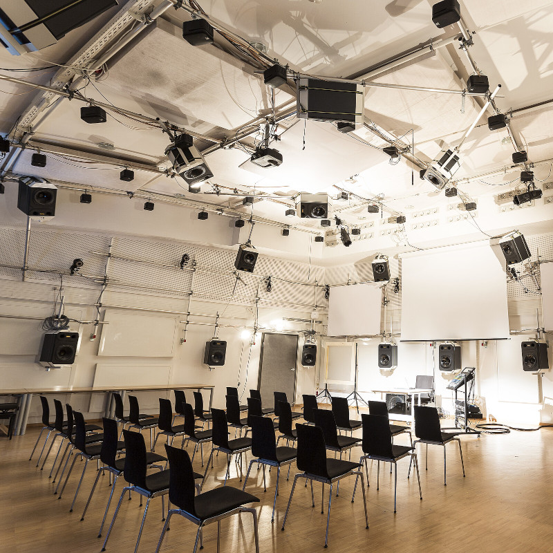
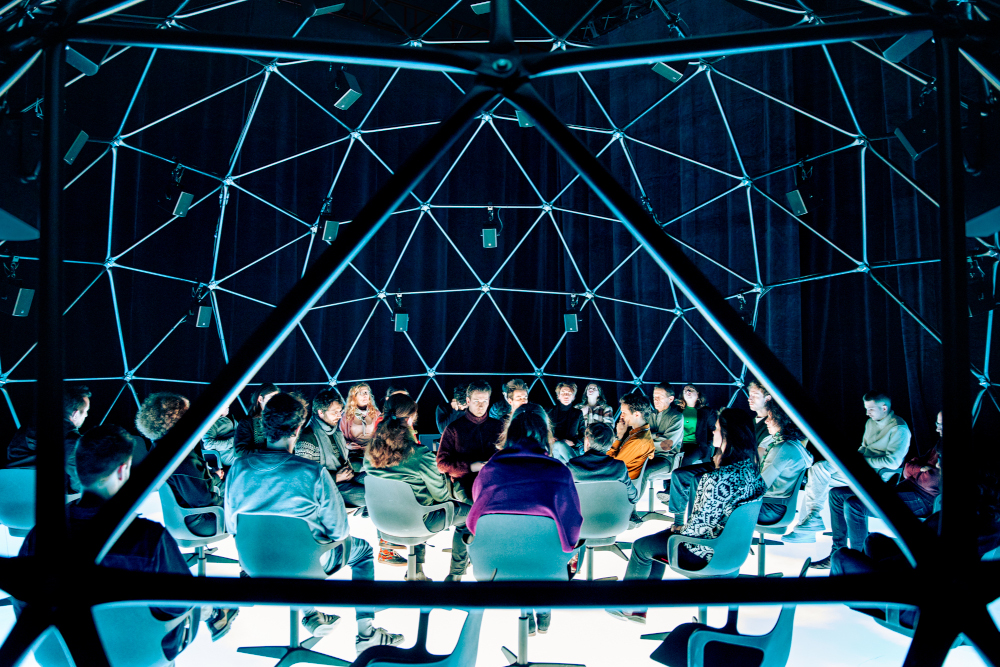
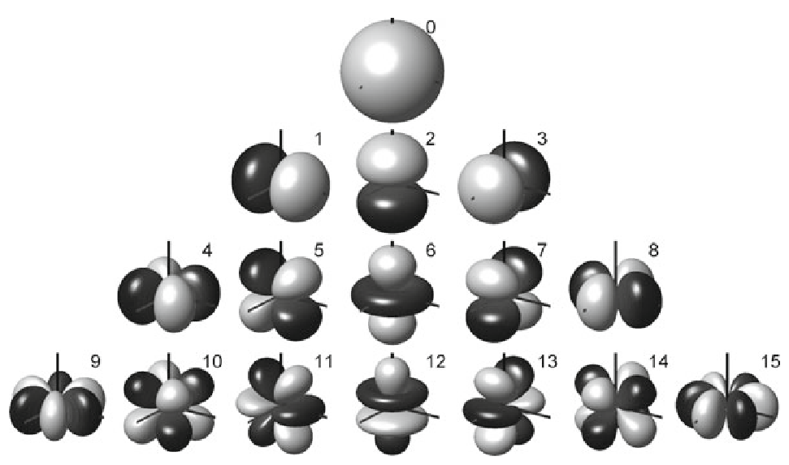
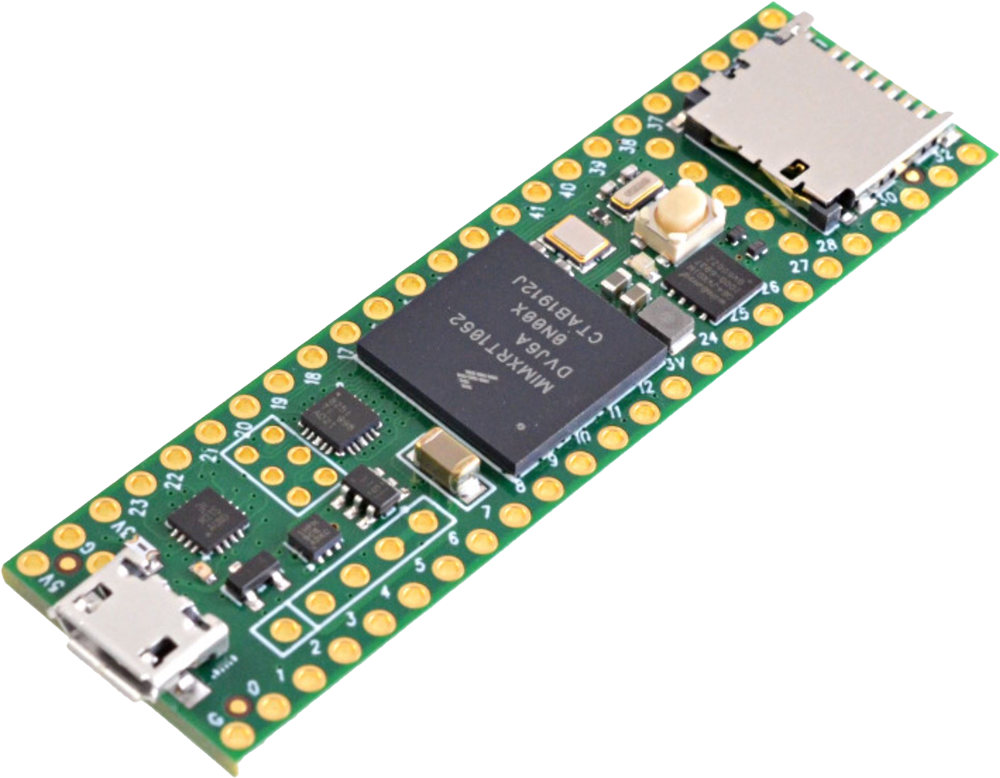
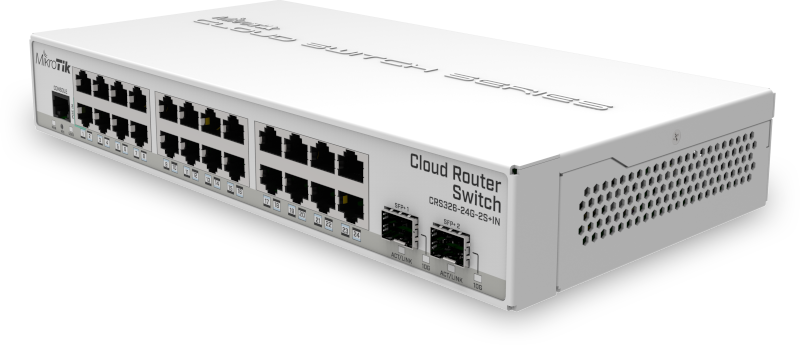

#+title: Ambisonics
#+subtitle: Introducing an Accessible, Distributed Approach
#+author: Thomas Rushton, Romain Michon, Tanguy Risset, Clemens Wegener, Pierre Lecomte
#+date: November 2026

#+property: header-args:typst :tangle out/theme.typ :noeval
#+options: toc:nil num:nil
#+export_file_name: out/smc-2026-slides
#+include: "out/theme.typ" export typst

* Typst setup                                                      :noexport:

** Symlink images

#+begin_src emacs-lisp :results none :export none :eval yes
(dired-make-relative-symlink "images" "out/images" t)
#+end_src
  
** Template

[[https://github.com/skriptum/diatypst][Diatypst]] is nice and simple, but a little too simple; I want to be
able to add some images to the title page. Perhaps I should've forked
it... but I really don't want to be learning more than superficial
Typst right now, thank you very much.

Most of the template follows unchanged:

#+begin_src typst
#let layouts = (
  "small": ("height": 9cm, "space": 1.4cm),
  "medium": ("height": 10.5cm, "space": 1.6cm),
  "large": ("height": 12cm, "space": 1.8cm),
)

#let slides(
  content,
  title: none,
  subtitle: none,
  footer-title: none,
  footer-subtitle: none,
  date: none,
  authors: (),
  layout: "medium",
  ratio: 4/3,
  title-color: none,
  bg-color: white,
  count: "dot",
  footer: true,
  toc: true,
  theme: "normal"
) = {

  // Parsing
  if layout not in layouts {
      panic("Unknown layout " + layout)
  }
  let (height, space) = layouts.at(layout)
  let width = ratio * height

  if count not in (none, "dot", "number") {
    panic("Unknown Count, valid counts are 'dot' and 'number', or none")
  }

  if theme not in ("normal", "full") {
      panic("Unknown Theme, valid themes are 'full' and 'normal'")
  }

  // Colors
  if title-color == none {
      title-color = blue.darken(50%)
  }
  let block-color = title-color.lighten(90%)
  let body-color = title-color.lighten(80%)
  let header-color = title-color.lighten(65%)
  let fill-color = title-color.lighten(50%)

  // Setup
  set document(
    title: title,
    author: authors,
  )
  set heading(numbering: "1.a")

  // PAGE----------------------------------------------
  set page(
    fill: bg-color,
    width: width,
    height: height,
    margin: (x: 0.5 * space, top: space, bottom: 0.6 * space),
#+end_src

*** Header

Make sure headings are top-left aligned.

#+begin_src typst
  // HEADER
    header: [
      #context {
        let page = here().page()
        let headings = query(selector(heading.where(level: 2)))
        let heading = headings.rev().find(x => x.location().page() <= page)

        if heading != none {
          set align(top + left)
          if (theme == "full") {
            block(
              width: 100%,
              fill: title-color,
              height: space * 0.85,
              outset: (x: 0.5 * space)
            )[
              #set text(1.4em, weight: "bold", fill: bg-color)
              #v(space / 2)
              #heading.body
              #if not heading.location().page() == page [
                #{numbering("(i)", page - heading.location().page() + 1)}
              ]
            ]
          } else if (theme == "normal") {
            set text(1.4em, weight: "bold", fill: title-color)
            v(space / 2)
            heading.body
            if not heading.location().page() == page [
              #{numbering("(i)", page - heading.location().page() + 1)}
            ]
          }
        }
    }
  // COUNTER
    #if count == "dot" {
      v(-space / 1.5)
      set align(right + top)
      context {
        let last = counter(page).final().first()
        let current = here().page()
        // Before the current page
        for i in range(1,current) {
          link((page:i, x:0pt,y:0pt))[
            #box(circle(radius: 0.08cm, fill: fill-color, stroke: 1pt+fill-color))
          ]
        }
        // Current Page
        link((page:current, x:0pt,y:0pt))[
            #box(circle(radius: 0.08cm, fill: fill-color, stroke: 1pt+fill-color))
          ]
        // After the current page
        for i in range(current+1,last+1) {
          link((page:i, x:0pt,y:0pt))[
            #box(circle(radius: 0.08cm, stroke: 1pt+fill-color))
          ]
        }
      }
    } else if count == "number" {
      v(-space / 1.5)
      set align(right + top)
      context {
        let last = counter(page).final().first()
        let current = here().page()
        set text(weight: "bold")
        set text(fill: white) if theme == "full"
        set text(fill: title-color) if theme == "normal"
        [#current / #last]
      }
    }
    ],
    header-ascent: 0%,
  // FOOTER
    footer: [
      #if footer == true {
        set text(0.7em)
        // Colored Style
        if (theme=="full") {
          columns(2, gutter:0cm)[
            // Left side of the Footer
            #align(left)[#block(
              width: 100%,
              outset: (left:0.5*space, bottom: 0cm),
              height: 0.3*space,
              fill: fill-color,
              inset: (right:3pt)
            )[
              #v(0.1*space)
              #set align(right)
              #smallcaps()[#if footer-title != none {footer-title} else {title}]
              ]
            ]
            // Right Side of the Footer
            #align(right)[#block(
              width: 100%,
              outset: (right:0.5*space, bottom: 0cm),
              height: 0.3*space,
              fill: body-color,
              inset: (left: 3pt)
            )[
              #v(0.1*space)
              #set align(left)
              #if footer-subtitle != none {
                  footer-subtitle
              } else if subtitle != none {
                  subtitle
              } else if authors != none {
                    if (type(authors) != array) {authors = (authors,)}
                    authors.join(", ", last: " and ")
                  } else [#date]
            ]
          ]
          ]
        }
        // Normal Styling of the Footer
        else if (theme == "normal") {
          box()[#line(length: 50%, stroke: 2pt+fill-color )]
          box()[#line(length: 50%, stroke: 2pt+body-color)]
          v(-0.3cm)
          grid(
            columns: (1fr, 1fr),
            align: (right,left),
            inset: 4pt,
            [#smallcaps()[
              #if footer-title != none {footer-title} else {title}]],
            [#if footer-subtitle != none {
                footer-subtitle
            } else if subtitle != none {
                subtitle
            } else if authors != none {
                  if (type(authors) != array) {authors = (authors,)}
                  authors.join(", ", last: " and ")
                } else [#date]
            ],

          )
        }
      }
    ],
    footer-descent:0.3*space,
  )

  // SLIDES STYLING--------------------------------------------------
  // Section Slides
  show heading.where(level: 1): x => {
    set page(header: none,footer: none, margin: 0cm)
    set align(horizon)
      grid(
        columns: (1fr, 3fr),
        inset: 10pt,
        align: (right,left),
        fill: (title-color, bg-color),
        [#block(height: 100%)],[#text(1.2em, weight: "bold", fill: title-color)[#x]]
      )

  }
  show heading.where(level: 2): pagebreak(weak: true) // this is where the magic happens
  show heading: set text(1.1em, fill: title-color)

  // ADD. STYLING --------------------------------------------------
  // Terms
  show terms.item: it => {
    set block(width: 100%, inset: 5pt)
    stack(
      block(fill: header-color, radius: (top: 0.2em, bottom: 0cm), strong(it.term)),
      block(fill: block-color, radius: (top: 0cm, bottom: 0.2em), it.description),
    )
  }

  // Code
  show raw.where(block: false): it => {
    box(fill: block-color, inset: 1pt, radius: 1pt, baseline: 1pt)[#text(it)]
  }

  show raw.where(block: true): it => {
    block(radius: 0.5em, fill: block-color,
          width: 100%, inset: 1em, it)
  }

  // Bullet List
  show list: set list(marker: (
    text(fill: title-color)[•],
    text(fill: title-color)[‣],
    text(fill: title-color)[-],
  ))

  // Enum
  let color_number(nrs) = text(fill:title-color)[*#nrs.*]
  set enum(numbering: color_number)

  // Table
  show table: set table(
    stroke: (x, y) => (
      x: none,
      bottom: 0.8pt+black,
      top: if y == 0 {0.8pt+black} else if y==1 {0.4pt+black} else { 0pt },
    )
  )

  show table.cell.where(y: 0): set text(
    style: "normal", weight: "bold") // for first / header row

  set table.hline(stroke: 0.4pt+black)
  set table.vline(stroke: 0.4pt)

  // Quote
  set quote(block: true)
  show quote.where(block: true): it => {
    v(-5pt)
    block(
      fill: block-color, inset: 5pt, radius: 1pt,
      stroke: (left: 3pt+fill-color), width: 100%,
      outset: (left:-5pt, right:-5pt, top: 5pt, bottom: 5pt)
      )[#it]
    v(-5pt)
  }

  // Link
  show link: it => {
    if type(it.dest) != str { // Local Links
      it
    }
    else {
      underline(stroke: 0.5pt+title-color)[#it] // Web Links
    }
  }

  // Outline
  set outline(
    // target: heading.where(level: 1),
    indent: auto,
  )

  show outline: set heading(level: 2) // To not make the TOC heading a section slide by itself

  // Bibliography
  set bibliography(
    title: none
  )
#+end_src

*** Title page

Again, as per the original template to start:

#+begin_src typst
  // CONTENT---------------------------------------------
  // Title Slide
  if (title == none) {
    panic("A title is required")
  }
  else {
    if (type(authors) != array) {
      authors = (authors,)
    }
    set page(footer: none, header: none, margin: 0cm)
    block(
      inset: (x:0.5*space, y:1em),
      fill: title-color,
      width: 100%,
      height: 60%,
      align(bottom)[#text(2.0em, weight: "bold", fill: bg-color, title)]
    )
    block(
      height: 30%,
      width: 100%,
      inset: (x:0.5*space,top:0cm, bottom: 1em),
      if subtitle != none {[
        #text(1.4em, fill: title-color, weight: "bold", subtitle)
      ]} +
      if subtitle != none and date != none { text(1.4em)[ \ ] } +
      if date != none {text(1.1em, date)} +
      align(left+bottom, authors.join(", ", last: " & "))
    )
#+end_src

*** Logos

With the addition of some logos in the header.

#+begin_src typst
    place(top + right, dx: -2em, dy: 2em)[
        #stack(
          dir: ltr,
          spacing: 2em,
          image("images/inria_blanc.png", height: 2.5em),
          image("images/insa_blanc_crop.png", height: 2.6em),
          image("images/citi_blanc.png", height: 3em)
        )
    ]
  }

  // Outline
  if (toc == true) {
    outline()
  }
#+end_src

*** Normal content

Vertically centre the content of normal slides.

#+begin_src typst
  // Normal Content
  set align(horizon + center)
  content
}
#+end_src

** Typography

#+begin_src typst
#set text(font: "Minion Pro", number-type: "old-style")
#show math.equation: set text(font: "New Computer Modern Math")
#show raw: set text(font: "Iosevka Comfy Motion", number-type: "lining")
#+end_src

** Slide setup

#+begin_src typst
#let subtitle = "Introducing an Accessible, Distributed Approach"

#context[
  #show: slides.with(
    title: text(style: "italic")[#document.title],
    subtitle: subtitle,
    authors: document.author.first(),

    title-color: green.darken(66%),
    ratio: 16/9,
    layout: "medium", // one of "small", "medium", "large"
    footer-subtitle: "Rushton, Michon, Risset, Wegener, Lecomte",
    theme: "normal", // one of "normal", "full"
  )
#+end_src

* Figures                                                          :noexport:
:PROPERTIES:
:header-args: :tangle smc26figs.sty :results silent :noeval 
:END:

OK, let's define some figures, in Tikz, since I'm more familiar with
it, plus they might better lend themselves to re-use.

The idea is to write some Tikz functions, tangle them to a file, and
include them in LaTeX source blocks here, and in regular markup in
=poster.org=.

** Setup

#+begin_src latex
\ProvidesPackage{smc26figs}
\usepackage{tikz}
\usetikzlibrary{shapes, positioning, arrows.meta}
\usepackage{fontspec}
\setmainfont[
  Mapping={tex-text}, 
  Numbers={OldStyle},
  Ligatures={Common},
  UprightFont=*-Regular,
  BoldFont=*-Bold,
  BoldItalicFont=*-BoldIt,
  ItalicFont=*-It,
  FontFace={sb}{n}{*-Semibold},
  FontFace={sb}{it}{*-SemiboldIt}
]{MinionPro}
#+end_src

** Common stuff

Define some colours and some node and line styles.

#+begin_src latex
\definecolor{ctrlColour}{HTML}{479955}
\definecolor{audioColour}{HTML}{4077D6}
\definecolor{usbColour}{HTML}{D63E3E}

\pgfdeclarelayer{superbackground}
\pgfdeclarelayer{background}
\pgfdeclarelayer{foreground}
\pgfdeclarelayer{superforeground}
\pgfsetlayers{superbackground,background,main,foreground,superforeground}

\tikzset{
  device/.style={draw, fill=black!10, rounded corners=1mm, inner xsep=1.5mm, align=center},
  ctrl/.style={densely dotted, ctrlColour, line width=.2mm},
  ctrlArrow/.style={ctrl, -{Triangle[open]}},
  acn/.style={-{Stealth}, audioColour, densely dashdotted},
  audio/.style={-{Stealth}, audioColour},
  ptp/.style={{Triangle}-{Triangle}},
  usb/.style={{Triangle[open]}-{Triangle[open]}, usbColour},
  legend/.style={font=\tiny\itshape},
  module/.style={device, fill=ctrlColour!35, transform shape},
  authority/.style={device, fill=usbColour!35}
}
#+end_src

** System overview

#+begin_src latex
\tikzset{
  systemOverview/.pic={
    \node (auth) [authority] at (0, 0) {Time\\authority};
    \node (switch) [device, above=5mm of auth, inner xsep=10mm] {Switch};
    \node (server) [device, below=5mm of auth, inner xsep=10mm] {Server};
    \node (module0) [module, above left=5mm and -8mm of switch] {T41};
    \node (moduleN) [module, above right=5mm and -8mm of switch] {T41};
    \node [above=5mm of switch] {\(\cdots\)};

    % PTP between authority and switch
    \draw [ptp] (auth.north) -- (switch.south);

    % PTP between switch and modules
    \draw [ptp] ([xshift=-13.3mm]switch.north) --
    ([xshift=-2mm]module0.south);
    \draw [ptp] ([xshift=9.3mm]switch.north) --
    ([xshift=-2mm]moduleN.south);

    % USB audio
    \draw [usb] ([xshift=-4mm]auth.south) --
    ([xshift=-4mm]server.north);

    % PTP follow-up from authority to server
    \draw [-{Triangle}] ([xshift=4mm]auth.south) --
    ([xshift=4mm]server.north);

    % Audio from server to switch
    \draw [audio] ([xshift=-12.5mm]server.north) --
    ([xshift=-12.5mm]switch.south);

    % Ctrl from server to switch
    \draw [ctrlArrow] ([xshift=12.5mm]server.north) --
    ([xshift=12.5mm]switch.south);

    % Audio from switch to modules
    \draw [audio] ([xshift=-11.3mm]switch.north) -- (module0.south);
    \draw [audio] ([xshift=11.3mm]switch.north) -- (moduleN.south);

    % Ctrl from switch to modules
    \draw [ctrlArrow] ([xshift=-9.3mm]switch.north) --
    ([xshift=2mm]module0.south);
    \draw [ctrlArrow] ([xshift=13.3mm]switch.north) --
    ([xshift=2mm]moduleN.south);
  }
}
#+end_src

** HOA

#+begin_src latex
\tikzset{
  selector/.pic={
    \draw[rotate=45, very thick, ctrlColour] (-#1,0) -- (#1,0);
    \draw[rotate=45, very thick, ctrlColour] (0,-#1) -- (0, #1);
  },
  speakerHOA/.pic = {
    \draw (-.11, 0) rectangle (.11, .06);
    \draw (-.11, .06) -- (-.25, .2) -- (.25, .2) -- (.11, .06);
    \node (-body) at (0, 0) {};   % invisible anchor node
  },
  moduleN/.pic = {
    \node [module] (-body) {dHOA};
    \draw [ptp] (0, .6) -- (-body.north);
    \draw [acn] (-.25, .6) -- ([xshift=-.25cm]-body.north);
    \draw [ctrlArrow] (.25, .6) -- ([xshift=.25cm]-body.north);
  },
  moduleS/.pic = {
    \node [module] (-body) {dHOA};
    \draw [ptp] (0, -.6) -- (-body.south);
    \draw [acn] (-.25, -.6) -- ([xshift=-.25cm]-body.south);
    \draw [ctrlArrow] (.25, -.6) -- ([xshift=.25cm]-body.south);
  },
  hoa/.pic={
    \begin{scope}[yshift=11.5cm]
      % Synthesised soundfield
      \draw [thick] (-4, -4) rectangle (4, 4);
      % Azymuthal rings
      \draw [dashed, black!30] (0, 0) circle (3.5);
      \draw [dashed, black!30] (0, 0) circle (1.9);
      % Speakers, ring 0
      \pic [rotate=180] (speaker0) at (0, 3.7) {speakerHOA};
      \pic [rotate=135] (speaker1) at (2.625, 2.625) {speakerHOA};
      \pic [rotate=90] (speaker2) at (3.7, 0) {speakerHOA};
      \pic [rotate=45] (speaker3) at (2.625, -2.625) {speakerHOA};
      \pic (speaker4) at (0, -3.7) {speakerHOA};
      \pic [rotate=-45] (speaker5) at (-2.625, -2.625) {speakerHOA};
      \pic [rotate=-90] (speaker6) at (-3.7, 0) {speakerHOA};
      \pic [rotate=-135] (speaker7) at (-2.625, 2.625) {speakerHOA};
      % Speakers, ring 1
      \pic [rotate=202.5] (speaker8) at (-.8, 1.925) {speakerHOA};
      \pic [rotate=157.5] (speaker9) at (.8, 1.925) {speakerHOA};
      \pic [rotate=112.5] (speaker10) at (1.925, .8) {speakerHOA};
      \pic [rotate=67.5] (speaker11) at (1.925, -.8) {speakerHOA};
      \pic [rotate=22.5] (speaker12) at (.8, -1.925) {speakerHOA};
      \pic [rotate=-22.5] (speaker13) at (-.8, -1.925) {speakerHOA};
      \pic [rotate=-67.5] (speaker14) at (-1.925, -.8) {speakerHOA};
      \pic [rotate=-112.5] (speaker15) at (-1.925, .8) {speakerHOA};
      % Modules
      \pic [rotate=-22.5] (module0) at (1.5, 3.5) {moduleS};
      \pic [rotate=67.5] (module1) at (3.5, -1.5) {moduleN};
      \pic [rotate=-22.5] (module2) at (-1.5, -3.5) {moduleN};
      \pic [rotate=67.5] (module3) at (-3.5, 1.5) {moduleS};
      \pic (module4) at (0, 2.25) {moduleN};
      \pic (module5) [rotate=90] at (2.25, 0) {moduleS};
      \pic (module6) at (0, -2.25) {moduleS};
      \pic [rotate=-90] (module7) at (-2.25, 0) {moduleS};
      % Audio
      \draw [audio] (module0-body.west) -- ([xshift=-.05cm]speaker0-body.east);
      \draw [audio] (module0-body.east) -- ([yshift=.05cm, xshift=.1cm]speaker1-body.west);
      \draw [audio] (module1-body.east) -- ([yshift=-.1cm, xshift=.1cm]speaker2-body.west);
      \draw [audio] (module1-body.west) -- ([yshift=.05cm, xshift=-.1cm]speaker3-body.east);
      \draw [audio] (module2-body.east) -- ([yshift=.05cm, xshift=.05cm]speaker4-body.west);
      \draw [audio] (module2-body.west) -- ([yshift=-.05cm]speaker5-body.east);
      \draw [audio] (module3-body.west) -- ([yshift=.1cm, xshift=-.1cm]speaker6-body.east);
      \draw [audio] (module3-body.east) -- ([yshift=-.05cm, xshift=.1cm]speaker7-body.west);
      \draw [audio] (module4-body.west) -- ([yshift=.125cm]speaker8-body.south);
      \draw [audio] (module4-body.east) -- ([yshift=.125cm]speaker9-body.south);
      \draw [audio] (module5-body.east) -- ([yshift=.125cm]speaker10-body.south);
      \draw [audio] (module5-body.west) -- ([yshift=.1cm]speaker11-body.south);
      \draw [audio] (module6-body.east) -- ([yshift=.125cm]speaker12-body.south);
      \draw [audio] (module6-body.west) -- ([yshift=.125cm]speaker13-body.south);
      \draw [audio] (module7-body.east) -- ([yshift=.1cm]speaker14-body.south);
      \draw [audio] (module7-body.west) -- ([yshift=.125cm]speaker15-body.south);
    \end{scope}
    \begin{scope}[yshift=5.5cm]
      % Switch
      \node[device, inner xsep=8mm, inner ysep=2.5mm](switch) at (0, 1) {Switch};
      % Time authority
      \node[authority, align=center](authority) at (0, -.5) {Time\\authority};
      % PTP
      \draw [{Triangle}-] (.5, -1.5) -- ([xshift=5mm] authority.south);
      \draw [ptp] (authority.north) -- (switch.south);
      \draw [ptp] (switch.north) -- (0, 2);
      % USB
      \draw [usb] (-.5, -1.5) -- ([xshift=-5mm] authority.south);
      % ACN-format
      \draw [acn] (-1.1, -1.5) -- ([xshift=-1.1cm] switch.south);
      \draw [acn] ([xshift=-1.1cm] switch.north) -- (-1.1, 2);
      % Coordinates
      \draw [ctrlArrow] (1.1, -1.5) -- ([xshift=1.1cm] switch.south);
      \draw [ctrlArrow] ([xshift=1.1cm] switch.north) -- (1.1, 2);
    \end{scope}
    \begin{scope}
      % DAW
      \draw [thick] (-4, -4) rectangle (4, 4);
      \node [] at (-3.25, 3.5) {DAW};
      % Virtual soundfield
      \draw [thick] (0, 0) circle (3.5);
      \node [black!75, align=center, font={\itshape}] at (0, 0) {Virtual\\soundfield};
      % Azymuthal rings
      \draw [dotted, black!50] (0, 0) circle (1.9);
      % Module selectors
      \pic at (1.2, 3.275) {selector=5pt};
      \pic at (3.275, -1.2) {selector=5pt};
      \pic at (-1.2, -3.275) {selector=5pt};
      \pic at (-3.275, 1.2) {selector=5pt};
      \pic at (0, 1.9) {selector=5pt};
      \pic at (1.9, 0) {selector=5pt};
      \pic at (0, -1.9) {selector=5pt};
      \pic at (-1.9, 0) {selector=5pt};
      % Speakers, ring 0
      \pic [rotate=180] (speaker0) at (0, 3.7) {speakerHOA};
      \pic [rotate=135] (speaker1) at (2.625, 2.625) {speakerHOA};
      \pic [rotate=90] (speaker2) at (3.7, 0) {speakerHOA};
      \pic [rotate=45] (speaker3) at (2.625, -2.625) {speakerHOA};
      \pic (speaker4) at (0, -3.7) {speakerHOA};
      \pic [rotate=-45] (speaker5) at (-2.625, -2.625) {speakerHOA};
      \pic [rotate=-90] (speaker6) at (-3.7, 0) {speakerHOA};
      \pic [rotate=-135] (speaker7) at (-2.625, 2.625) {speakerHOA};
      % Speakers, ring 1
      \pic [rotate=202.5] (speaker8) at (-.8, 1.925) {speakerHOA};
      \pic [rotate=157.5] (speaker9) at (.8, 1.925) {speakerHOA};
      \pic [rotate=112.5] (speaker10) at (1.925, .8) {speakerHOA};
      \pic [rotate=67.5] (speaker11) at (1.925, -.8) {speakerHOA};
      \pic [rotate=22.5] (speaker12) at (.8, -1.925) {speakerHOA};
      \pic [rotate=-22.5] (speaker13) at (-.8, -1.925) {speakerHOA};
      \pic [rotate=-67.5] (speaker14) at (-1.925, -.8) {speakerHOA};
      \pic [rotate=-112.5] (speaker15) at (-1.925, .8) {speakerHOA};
    \end{scope}
  }
}
#+end_src

* Ambisonics

** Ambisonics

#+typst: #columns(2, [

#+attr_org: :width 200
#+attr_typst: :height 5.5cm

#+typst: #colbreak()

#+attr_org: :width 200

#+typst: ])

** Ambisonics

#+typst: #columns(2, [

#+attr_org: :width 200
#+attr_typst: :height 4.5cm

#+typst: #colbreak() #align(left)[

- A sound field synthesis technique.
- Decomposes a sound field onto a truncated basis of spherical
  harmonics.
- Abisonic /order/ \(M\) determines the number of spherical harmonics.
- Number of loudspeakers: \(N \ge (M + 1)^{2}\)
- The higher the number of loudspeakers, the greater the ambisonic
  order, the better.
- Higher order ambisonics (HOA) refers to ambisonics of greater than
  order 1.

#+typst: ]])

** Ambisonics

Ambisonics systems are typically centralised and very costly.

Highly multichannel audio interfaces alone cost € thousands.

We seek to lower the barrier to entry for sound field synthesis
techniques by taking a distributed approach.

* The Hardware Platform

** A Humble Microcontroller Development Board

#+typst: #columns(2, [

#+attr_org: :width 200
#+attr_typst: :height 6cm

#+typst: #colbreak() #align(left)[

- Teensy 4.1 (~https://pjrc.com~)
- 600 MHz Arm Core-M7, FPU, DSP, SIMD
- MCU with dedicated audio subsystem
- Ethernet subsystem with IEEE 1588 PTP support
- \~€ 30  + \~€ 15 with ethernet and audio add-ons
- Well-known to the maker/DIY community
- Memory-poor — 1024 kB (+ 16 MB PSRAM)

#+typst: ]])

** A PTP-capable Switch

#+typst: #columns(2, [

#+attr_org: :width 200

#+typst: #colbreak() #align(left)[

- Most low-cost networking equipment doesn't support PTP.
- Most PTP-capable networking equipment is expensive.
- We found a PTP-capable switch that provides 24 PTP-enabled ports for
  €200.

#+typst: ]])

** The Networked Audio System

#+typst: #grid(columns: (60%, 40%), [

#+header: :exports results :results file raw :file "./images/gen/system-overview.png"
#+header: :imagemagick t :iminoptions -density 600 :imoutoptions -geometry 2000 -flatten :fit t
#+header: :headers '("\\usepackage{smc26figs}")
#+begin_src latex :eval no-export
\begin{tikzpicture}
  \pic{systemOverview};
   \matrix [draw] at (3, 0) {
    \draw [ctrlArrow] (0,0) -- (.5,0); & \node [legend] {Control data (UDP)}; \\
    \draw [audio] (0,0) -- (.5,0); & \node [legend] {Audio (UDP)}; \\
    \draw [-{Triangle[open]}, usbColour] (0,0) -- (.5,0); & \node [legend] {USB audio}; \\
    \draw [-{Triangle}] (0,0) -- (.5,0); & \node [legend] {PTP}; \\
  };
\end{tikzpicture}
#+end_src
#+attr_org: :width 200
#+RESULTS:
[[file:./images/gen/system-overview.png]]

#+typst: ],[

The time authority is a Teensy 4.1 running as a USB audio device /and/ a
PTP clock authority.

It governs audio time for the server and PTP time for the network of
DSP modules.

The modules run media clock recovery and presentation time recovery
algorithms.

The server runs in a HOA-control DAW plugin on a general-purpose
computer.

#+typst: ])

* Distributed Ambisonics

** Distributed Ambisonics

#+typst: #columns(2, [

#+header: :exports results :results file raw :file "./images/gen/hoa.png"
#+header: :imagemagick t :iminoptions -density 600 :imoutoptions -geometry 2000 -flatten :fit t
#+header: :headers '("\\usepackage{smc26figs}")
#+begin_src latex :eval no-export
\begin{tikzpicture}
  \pic{hoa};
  \matrix [draw] at (-2.75, 5.75) {
    \draw [ctrlArrow] (0,0) -- (.5,0); & \node [legend] {Decoder coeff's}; \\
    \draw [acn] (0,0) -- (.5,0); & \node [legend] {ACN-format}; \\
    \draw [audio] (0,0) -- (.5,0); & \node [legend] {Audio}; \\
    \draw [-{Triangle}] (0,0) -- (.5,0); & \node [legend] {PTP}; \\
    \draw [usb] (0,0) -- (.5,0); & \node [legend] {USB}; \\
    \pic at (.25, 0) {selector=5pt}; & \node [legend] {Module selector}; \\
  };
\end{tikzpicture}
#+end_src
#+attr_org: :width 200
#+RESULTS:
[[file:./images/gen/hoa.png]]

#+typst: #colbreak()

The ambisonics algorithm can be parallelised.

The decoder matrix, \(\mathbf{D}\), is found as the inverse of the
mode matrix, \(\mathbf{Y}\) (the matrix of spherical harmonics).

Each row of \(\mathbf{D}\) contains the decoding co-efficients for one
loudspeaker.

Each ambisonics module, handling two channels of output, need only be
aware of two rows of the decoder matrix.

#+typst: ])

* Deployment

** Deployment

#+typst: #columns(2, [

#+attr_org: :width 200
[[./images/hoa-control.png]]

#+typst: #colbreak()

The HOA control plugin permits entering loudspeakers' cartesian
co-ordinates.

It also has dropdown menus for assigning Teensy modules to pairs of
loudspeakers.

On assigning a module to loudspeaker pair, decoder matrix rows are
transmitted to the module as an OSC bundle.

#+typst: ])

* Outlook

** Next steps

Higher ambisonics orders...

#+typst: #text(size: .66em)[
#+begin_quote
/...up to fifth order possible while respecting ethernet's maximum
transmissible unit... can we go higher by dropping to eight frames per
audio packet?../
#+end_quote
#+typst: ] #v(.5cm)

More output channels per module via time division multiplexing...

#+typst: #text(size: .75em)[
#+begin_quote
/...up to thirty-two channels possible per device --- potentially lower
cost per output channel.../
#+end_quote
#+typst: ] #v(.5cm)

* Thank you!

* Close the Typst ~context~ block                                      :ignore:

#+typst: ]

* Local variables                                                  :noexport:

#+begin_example
Local Variables:
org-latex-compiler: "xelatex"
End:
#+end_example
